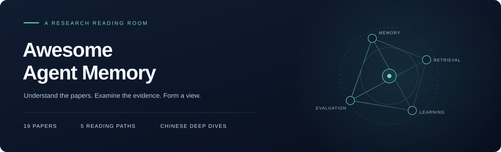
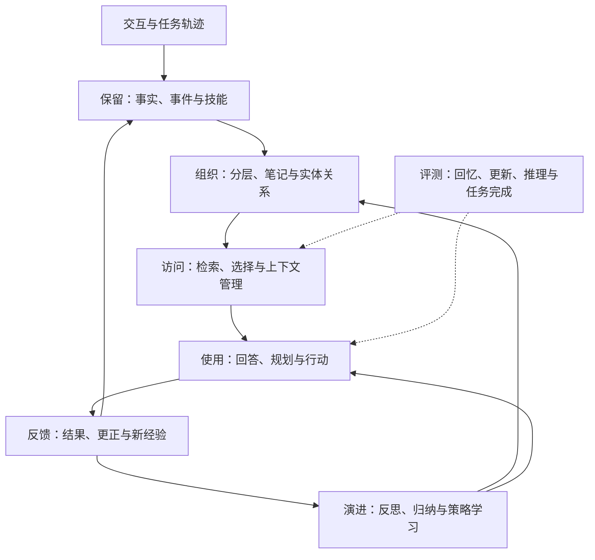

<h3>找到证据，记住经验</h3>

Agent Memory 与 RAG 论文的中文精读。

34 篇论文 · 10 条阅读路线 · 方法、实验、代码与数据

<a href="papers/14-hindsight.md">阅读 Hindsight</a> · <a href="guides/rag.md">RAG 专题</a> · <a href="#map">知识地图</a> · <a href="#routes">选择路线</a> · <a href="#index">论文目录</a> · <a href="guides/comparison.md">比较与术语</a> · <a href="guides/implementations-and-data.md">代码与数据</a>

## 从这里开始

一个 Agent 可以保存全部聊天，却依然记错日期、忽略新决定，或者把自己的建议当成已经确认的事实。它也可能答对历史问题，却无法在下一次行动中使用这段经验。

本库围绕这些问题读论文：信息如何被保留，怎样被组织和找到，何时需要更新，以及怎样证明过去的经验确实改善了未来的行为。文章从一般编程知识出发，逐步建立直觉，再进入数据结构、必要公式、算法过程与实验解释。

RAG 专题从另一个方向接近这些问题：怎样找到证据、怎样读懂多份资料，以及答错之后如何定位原因。新增 15 篇解析，与已有的 HippoRAG 2 组成 [16 篇 RAG 阅读路线](guides/rag.md)。

### 从 Hindsight 开始

**一项发布计划为什么延期，问题修复之后又应该怎样改变建议？**

从这组跨会话问题出发，看一条记录如何成为事实、如何关联项目与时间、如何被四路检索找回，以及新证据如何改变旧观点。文章也解释为什么“检索得分”“观点置信度”和“实验准确率”是三个不同的概念。

[开始完整阅读 →](papers/14-hindsight.md) · [直接看实验解读](papers/14-hindsight.md#s12) · [直接看总结与判断](papers/14-hindsight.md#s15)

<table>
<tr>
<td width="33%" valign="top">

**01 · 理解方法**

从具体问题进入，解释输入、处理过程与输出。术语配直觉，公式配演算，案例展示中间变化。

</td>
<td width="33%" valign="top">

**02 · 审视证据**

交代模型、数据、基线和预算。区分整体提升与组件贡献，也认真解释退步和缺失的信息。

</td>
<td width="33%" valign="top">

**03 · 形成判断**

以总结与看法收尾，讨论真正的贡献、适用条件、工程代价和下一步值得验证的假设。

</td>
</tr>
</table>

## 一张地图：记忆如何影响行动

下图是本库用于组织阅读问题的概念地图。它展示需要共同考虑的环节，不表示 19 篇论文采用同一套架构。

| 沿地图阅读时要问什么 | 可从哪些论文进入 |
| :--- | :--- |
| 应当保存原始记录、压缩事实，还是代码技能？ | MemoryBank、Generative Agents、Voyager |
| 记忆如何组织，才能在需要时被找到？ | MemGPT、MemoryOS、HippoRAG 2、A-Mem |
| 新证据如何改变旧认识，维护成本又在哪里？ | Mem0、LightMem、Hindsight |
| 一次经历怎样变成下一次任务可用的策略？ | Reflexion、ReasoningBank、Memory-R1 |
| 能回答历史问题，是否足以说明记忆有效？ | LongMemEval、LoCoMo、MemoryAgentBench、MemoryArena |

## Agent Memory 阅读路线

根据目标选择路线。重复出现的论文链接到同一篇解析，编号按原始清单首次出现顺序保留。

| 你的目标 | 建议阅读顺序 |
| :--- | :--- |
| **建立完整的学术认识** | [TOIS 记忆机制综述](papers/01-memory-survey.md) → [CoALA](papers/02-coala.md) → [Generative Agents](papers/03-generative-agents.md) → [Reflexion](papers/04-reflexion.md) → [Voyager](papers/05-voyager.md) |
| **研究长期用户记忆** | [MemoryBank](papers/06-memorybank.md) → [LongMemEval](papers/07-longmemeval.md) → [MemoryOS](papers/08-memoryos.md) → [Mem0](papers/09-mem0.md) |
| **设计记忆基础设施** | [CoALA](papers/02-coala.md) → [MemGPT](papers/10-memgpt.md) → [HippoRAG 2](papers/11-hipporag2.md) → [A-Mem](papers/12-amem.md) → [LightMem](papers/13-lightmem.md) → [Hindsight](papers/14-hindsight.md) |
| **研究持续改进的 Agent** | [Reflexion](papers/04-reflexion.md) → [Voyager](papers/05-voyager.md) → [ReasoningBank](papers/15-reasoningbank.md) → [Memory-R1](papers/16-memory-r1.md) → [MemoryArena](papers/17-memoryarena.md) |
| **建立评测体系** | [LongMemEval](papers/07-longmemeval.md) → [LoCoMo](papers/18-locomo.md) → [MemoryAgentBench](papers/19-memoryagentbench.md) → [MemoryArena](papers/17-memoryarena.md) |

先按目标选择路线，再根据下表补齐前置知识。

| 路线 | 建议前置知识 | 读完应能回答 |
| :--- | :--- | :--- |
| 学术认识 | 知道 LLM 的上下文与工具调用 | 不同记忆类型如何进入 Agent 的决策过程？ |
| 长期用户记忆 | 知道多轮对话与基本检索 | 事实、偏好与状态如何保留、更新和验证？ |
| 记忆基础设施 | 理解索引、持久化与后台任务；可先读 CoALA | 怎样组织读写、维护派生状态并控制访问成本？ |
| 从经验中改进 | 理解任务成功、失败与反馈 | 文字教训、代码技能和训练出的策略有何区别？ |
| 评测体系 | 理解准确率、召回率与实验对照 | 怎样分开测量记住、更新、推理和行动能力？ |

## 目录

编号保留五条原始路线中首次出现的顺序；分卷按研究问题组织。同一篇论文只维护一份解析。各篇均提供章节目录，方便按问题查阅。

### 01 · Foundations

建立记忆与认知架构的共同语言。

| 编号 | 论文解析 | 核心问题 | 关键贡献 | 原文 |
| :---: | :--- | :--- | :--- | :---: |
| 01 | [TOIS 记忆机制综述](papers/01-memory-survey.md) | 如何建立 Agent 记忆的完整分类？ | 用“来源、形式、操作、评测”给 Agent 记忆建立分类地图 | [↗](https://dl.acm.org/doi/10.1145/3748302) |
| 02 | [CoALA](papers/02-coala.md) | 记忆在 Agent 决策中处于什么位置？ | 把工作记忆、经历、知识和技能放到统一的决策框架中 | [↗](https://openreview.net/forum?id=1i6ZCvflQJ) |
| 03 | [Generative Agents](papers/03-generative-agents.md) | 记忆怎样支持连续而可信的行为？ | 记录经历、总结高层认识，再用相关记忆指导计划与行为 | [↗](https://arxiv.org/abs/2304.03442) |
| 04 | [Reflexion](papers/04-reflexion.md) | 失败后怎样改进下一次尝试？ | 把失败反馈变成可执行的文字教训，供下一次尝试使用 | [↗](https://papers.nips.cc/paper_files/paper/2023/hash/1b44b878bb782e6954cd888628510e90-Abstract-Conference.html) |
| 05 | [Voyager](papers/05-voyager.md) | 探索得到的能力怎样积累与复用？ | 把做成功的操作保存为代码技能，后续检索、组合并复用 | [↗](https://arxiv.org/abs/2305.16291) |

### 02 · Personal Memory

从长期对话中维护事实与用户理解。

| 编号 | 论文解析 | 核心问题 | 关键贡献 | 原文 |
| :---: | :--- | :--- | :--- | :---: |
| 06 | [MemoryBank](papers/06-memorybank.md) | 助手怎样长期理解用户？ | 保存长期对话与用户认识，并借助遗忘和强化机制管理记忆 | [↗](https://ojs.aaai.org/index.php/AAAI/article/view/29946) |
| 08 | [MemoryOS](papers/08-memoryos.md) | 近期对话与长期画像怎样协同？ | 用短期、中期和长期个人记忆管理近期上下文、主题内容与稳定画像 | [↗](https://aclanthology.org/2025.emnlp-main.1318/) |
| 09 | [Mem0](papers/09-mem0.md) | 新事实怎样更新已有记忆？ | 把新对话提取为候选事实，再与旧记忆比较后增删改或忽略 | [↗](https://arxiv.org/abs/2504.19413) |

### 03 · Memory Systems

组织、访问与维护不断增长的记忆。

| 编号 | 论文解析 | 核心问题 | 关键贡献 | 原文 |
| :---: | :--- | :--- | :--- | :---: |
| 10 | [MemGPT](papers/10-memgpt.md) | 上下文有限时如何访问长期信息？ | 让模型借助工具在有限上下文与外部存储之间调入、调出信息 | [↗](https://arxiv.org/abs/2310.08560) |
| 11 | [HippoRAG 2](papers/11-hipporag2.md) | 怎样找到只靠相似度会遗漏的证据？ | 借助图结构和 Personalized PageRank 找到不能只靠相似度定位的关联证据 | [↗](https://proceedings.mlr.press/v267/gutierrez25a.html) |
| 12 | [A-Mem](papers/12-amem.md) | 新记忆怎样改变旧笔记的组织？ | 把记忆写成互相关联的笔记，并让新信息推动旧笔记的理解更新 | [↗](https://proceedings.neurips.cc/paper_files/paper/2025/hash/19909c36f51abc4856b4560aff3d36d6-Abstract-Conference.html) |
| 13 | [LightMem](papers/13-lightmem.md) | 如何降低记忆维护的在线开销？ | 先压缩和按主题整理，再把昂贵的长期维护移到离线阶段 | [↗](https://proceedings.iclr.cc/paper_files/paper/2026/hash/a05b72653ec5b473732129829ae04195-Abstract-Conference.html) |
| 14 | [Hindsight](papers/14-hindsight.md) | 怎样区分证据、归纳和主观判断？ | 分清事实、经历、综合观察和观点，再用保留、回忆、反思三个操作访问 | [↗](https://aclanthology.org/2026.acl-demo.27/) |

### 04 · Learning from Experience

让过去的经验改变未来的策略。

| 编号 | 论文解析 | 核心问题 | 关键贡献 | 原文 |
| :---: | :--- | :--- | :--- | :---: |
| 15 | [ReasoningBank](papers/15-reasoningbank.md) | 如何从轨迹中提炼可迁移的策略？ | 从成功与失败轨迹中提炼可迁移的策略，再指导后续任务 | [↗](https://arxiv.org/abs/2509.25140) |
| 16 | [Memory-R1](papers/16-memory-r1.md) | 记忆管理与使用能否通过训练改进？ | 通过强化学习训练模型，让它更会管理记忆，也更会筛选和使用记忆 | [↗](https://aclanthology.org/2026.acl-long.583/) |

### 05 · Evaluation

分清记住、理解、更新与行动。

| 编号 | 论文解析 | 核心问题 | 关键贡献 | 原文 |
| :---: | :--- | :--- | :--- | :---: |
| 07 | [LongMemEval](papers/07-longmemeval.md) | 怎样检验跨会话记忆能力？ | 检查长时间交互中的事实提取、跨会话推理、更新、时间判断与拒答 | [↗](https://arxiv.org/abs/2410.10813) |
| 17 | [MemoryArena](papers/17-memoryarena.md) | 记忆能否帮助完成连续依赖任务？ | 检查 Agent 能否把前面任务的经验用于后续相互依赖的任务 | [↗](https://proceedings.mlr.press/v306/he26am.html) |
| 18 | [LoCoMo](papers/18-locomo.md) | 怎样评价超长期对话记忆？ | 通过长期对话检查事实回忆、跨事件理解、时间关系和回答一致性 | [↗](https://aclanthology.org/2024.acl-long.747/) |
| 19 | [MemoryAgentBench](papers/19-memoryagentbench.md) | 增量接收信息时有哪些不同记忆能力？ | 逐步输入信息，分别测试检索、测试时学习、长程理解和选择性遗忘 | [↗](https://proceedings.iclr.cc/paper_files/paper/2026/hash/fd1eff9dd295df50a41f2521942fa31d-Abstract-Conference.html) |

## RAG：从检索到回答

**为什么资料已经找到了，模型还是答错？** 从 [RAG](papers/20-rag.md)、[DPR](papers/21-dpr.md) 和 [FiD](papers/22-fid.md) 开始，分别理解架构、检索与阅读；再按任务深入查询改写、多步检索、文档组织和评测。

[完整阅读路线与英文题名 →](guides/rag.md) · [RAG 代码与数据 →](guides/rag-implementations-and-data.md)

| 目标 | 建议阅读顺序 |
| :--- | :--- |
| **先建立完整认识** | [RAG](papers/20-rag.md) → [DPR](papers/21-dpr.md) → [FiD](papers/22-fid.md) → [HyDE](papers/25-hyde.md) → [IRCoT](papers/26-ircot.md) → [Self-RAG](papers/27-self-rag.md) → [Lost in the Middle](papers/31-lost-in-the-middle.md) → [RAGChecker](papers/34-ragchecker.md) |
| **检索与索引设计** | [DPR](papers/21-dpr.md) → [SPLADE](papers/24-splade.md) → [ColBERTv2](papers/23-colbertv2.md) → [BEIR](papers/32-beir.md) |
| **长文档与企业知识库** | [RAG](papers/20-rag.md) → [HyDE](papers/25-hyde.md) → [RAPTOR](papers/29-raptor.md) → [GraphRAG](papers/30-graphrag.md) → [Lost in the Middle](papers/31-lost-in-the-middle.md) → [RAGChecker](papers/34-ragchecker.md) |
| **Agent 与多步检索** | [IRCoT](papers/26-ircot.md) → [Self-RAG](papers/27-self-rag.md) → [CRAG](papers/28-crag.md) → [HippoRAG 2](papers/11-hipporag2.md) |
| **评测与调优** | [BEIR](papers/32-beir.md) → [Lost in the Middle](papers/31-lost-in-the-middle.md) → [RAGAs](papers/33-ragas.md) → [RAGChecker](papers/34-ragchecker.md) |

### 06 · Retrieval-Augmented Generation

| 编号 | 论文解析 | 核心问题 | 原文 |
| :---: | :--- | :--- | :---: |
| 20 | [RAG](papers/20-rag.md) | 外部知识如何参与生成与联合训练？ | [↗](https://arxiv.org/abs/2005.11401) |
| 21 | [DPR](papers/21-dpr.md) | 如何学习问题与答案段落的匹配？ | [↗](https://aclanthology.org/2020.emnlp-main.550/) |
| 22 | [FiD](papers/22-fid.md) | 找到很多段资料之后，怎样一起读？ | [↗](https://aclanthology.org/2021.eacl-main.74/) |
| 23 | [ColBERTv2](papers/23-colbertv2.md) | 多向量怎样兼顾匹配细节与索引成本？ | [↗](https://aclanthology.org/2022.naacl-main.272/) |
| 24 | [SPLADE](papers/24-splade.md) | 神经语义能力怎样进入倒排索引？ | [↗](https://arxiv.org/abs/2107.05720) |
| 25 | [HyDE](papers/25-hyde.md) | 假想文档为什么能帮助寻找真实资料？ | [↗](https://aclanthology.org/2023.acl-long.99/) |
| 26 | [IRCoT](papers/26-ircot.md) | 新事实怎样决定下一次搜索？ | [↗](https://aclanthology.org/2023.acl-long.557/) |
| 27 | [Self-RAG](papers/27-self-rag.md) | 如何学会检索判断与证据检查？ | [↗](https://arxiv.org/abs/2310.11511) |
| 28 | [CRAG](papers/28-crag.md) | 第一次没搜对，系统怎样补救？ | [↗](https://arxiv.org/abs/2401.15884) |
| 29 | [RAPTOR](papers/29-raptor.md) | 如何同时检索细节与高层摘要？ | [↗](https://arxiv.org/abs/2401.18059) |
| 30 | [GraphRAG](papers/30-graphrag.md) | 怎样回答关于整批资料的问题？ | [↗](https://arxiv.org/abs/2404.16130) |
| 31 | [Lost in the Middle](papers/31-lost-in-the-middle.md) | 正确证据已经在场，为什么仍然答错？ | [↗](https://aclanthology.org/2024.tacl-1.9/) |
| 32 | [BEIR](papers/32-beir.md) | 换一个领域，检索模型还可靠吗？ | [↗](https://arxiv.org/abs/2104.08663) |
| 33 | [RAGAs](papers/33-ragas.md) | 缺少标准答案时，怎样自动检查回答？ | [↗](https://aclanthology.org/2024.eacl-demo.16/) |
| 34 | [RAGChecker](papers/34-ragchecker.md) | 答错之后，怎样定位该改的环节？ | [↗](https://arxiv.org/abs/2408.08067) |

[HippoRAG 2](papers/11-hipporag2.md) 连接 RAG 与长期记忆，沿用第 11 篇解析。

## 读完以后，应该能回答什么

- **记忆的内容**：历史、事实、反思、观点和代码技能分别承担什么角色？
- **记忆的组织**：平铺条目、分层主题、笔记网络与实体图，各自解决什么问题？
- **记忆的使用**：检索正确以后，为什么模型仍然可能读错或执行失败？
- **记忆的演进**：新事实怎样改变旧状态，经验怎样影响后续任务？
- **记忆的证据**：一个分数说明了什么，它背后的模型、预算和协议是什么？

[横向对比与术语解释 →](guides/comparison.md)

## 贯穿全书的三个问题

**保存原文与提炼经验承担不同职责。** 摘要和结构可以改善访问，但有损提取也可能删掉以后需要的条件。LongMemEval、A-Mem 与 LightMem 提供了不同角度。

**更复杂的记忆不一定更好。** 图结构、反思与离线更新都有维护成本，也可能带来错误。Mem0、Reflexion 与 LightMem 的结果包含有价值的反例。

**回忆与行动需要分开验证。** 能说出规则，不等于执行中始终遵守；能找回一个事实，不等于能完成连续任务。MemoryAgentBench 与 MemoryArena 让这一差别更清楚。

以上是本库基于各篇解析形成的阅读判断，具体证据与适用条件见文章。

---

Memory · Retrieval · Learning · Evaluation 
论文版权归原作者与出版方。本库提供中文解读、原创示例与评论。

