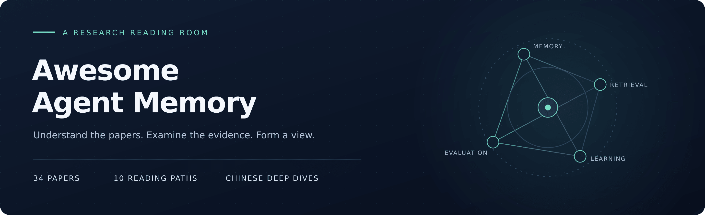
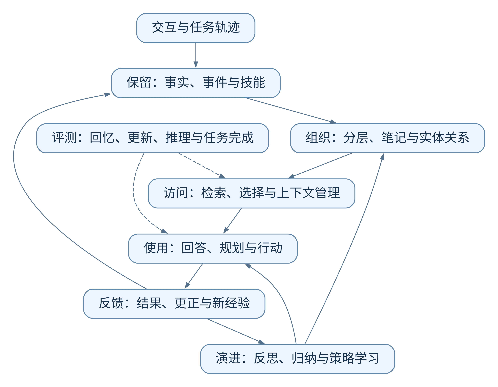

<h3>Agent Memory · RAG</h3>

关于记忆、检索与经验学习的论文精读

37 篇中文解析 · 22 篇记忆研究 · 15 篇 RAG 专题论文

<a href="#start">从哪里开始</a> ·
<a href="#routes">阅读路线</a> ·
<a href="#index">论文目录</a> ·
<a href="#resources">代码与数据</a>

---

Agent 怎样记住过去，又怎样用过去的经验完成下一次任务？

这里整理 Agent Memory 与 RAG 的代表性论文，用具体例子解释方法，结合实验讨论效果与局限，并提供原文、作者项目和数据入口。适合想理解论文，也想把方法用进系统的读者。

## 从哪里开始

第一次接触这个方向，可以先读 **[CoALA](papers/02-coala.md)** 和 **[RAG](papers/20-rag.md)**：前者解释记忆怎样参与 Agent 决策，后者解释外部资料怎样参与回答生成。

如果已经了解基本概念，可以从正在遇到的问题进入：

| 你关心的问题 | 建议先读 |
| :--- | :--- |
| 上下文放不下，历史信息怎样保存和调用？ | [MemGPT](papers/10-memgpt.md) |
| 事实、经历和归纳出来的认识，应该怎样组织？ | [Hindsight](papers/14-hindsight.md) |
| 事实发生变化后，怎样同时回答“现在”和“过去”？ | [Zep](papers/35-zep.md) |
| 摘要漏掉的细节，后来还能找回来吗？ | [GAM](papers/36-gam.md) |
| 做过一次的任务，怎样留下以后能用的经验？ | [Reflexion](papers/04-reflexion.md)、[ACE](papers/37-ace.md) |
| 答错了，怎样区分没找到证据与没有用好证据？ | [LongMemEval](papers/07-longmemeval.md)、[RAGChecker](papers/34-ragchecker.md) |

## 阅读路线

每条路线按理解问题的顺序排列，不是性能排名。可以先读前两三篇，再根据自己的任务继续。

### Agent Memory

| 方向 | 阅读顺序 |
| :--- | :--- |
| **基础认识** | [TOIS 记忆机制综述](papers/01-memory-survey.md) → [CoALA](papers/02-coala.md) → [Generative Agents](papers/03-generative-agents.md) → [Reflexion](papers/04-reflexion.md) → [Voyager](papers/05-voyager.md) |
| **长期用户记忆** | [MemoryBank](papers/06-memorybank.md) → [MemoryOS](papers/08-memoryos.md) → [Mem0](papers/09-mem0.md) → [Zep](papers/35-zep.md) |
| **记忆基础设施** | [MemGPT](papers/10-memgpt.md) → [HippoRAG 2](papers/11-hipporag2.md) → [Hindsight](papers/14-hindsight.md) → [Zep](papers/35-zep.md) → [GAM](papers/36-gam.md) |
| **从经验中改进** | [Reflexion](papers/04-reflexion.md) → [Voyager](papers/05-voyager.md) → [ReasoningBank](papers/15-reasoningbank.md) → [ACE](papers/37-ace.md) → [Memory-R1](papers/16-memory-r1.md) |
| **记忆评测** | [LongMemEval](papers/07-longmemeval.md) → [LoCoMo](papers/18-locomo.md) → [MemoryAgentBench](papers/19-memoryagentbench.md) → [MemoryArena](papers/17-memoryarena.md) |

### RAG

| 方向 | 阅读顺序 |
| :--- | :--- |
| **基础架构** | [RAG](papers/20-rag.md) → [DPR](papers/21-dpr.md) → [FiD](papers/22-fid.md) |
| **检索与索引** | [DPR](papers/21-dpr.md) → [SPLADE](papers/24-splade.md) → [ColBERTv2](papers/23-colbertv2.md) → [BEIR](papers/32-beir.md) |
| **长文档与知识库** | [HyDE](papers/25-hyde.md) → [RAPTOR](papers/29-raptor.md) → [GraphRAG](papers/30-graphrag.md) → [Lost in the Middle](papers/31-lost-in-the-middle.md) |
| **多步检索与纠错** | [IRCoT](papers/26-ircot.md) → [Self-RAG](papers/27-self-rag.md) → [CRAG](papers/28-crag.md) → [HippoRAG 2](papers/11-hipporag2.md) |
| **评测与调优** | [BEIR](papers/32-beir.md) → [Lost in the Middle](papers/31-lost-in-the-middle.md) → [RAGAs](papers/33-ragas.md) → [RAGChecker](papers/34-ragchecker.md) |

[展开 RAG 阅读指南 →](guides/rag.md) · [对照理解记忆方法 →](guides/comparison.md)

## 论文目录

按研究主题分类；点击论文名称阅读中文解析，右侧链接打开原文。HippoRAG 2 同时出现在记忆与 RAG 阅读路线中，只计一篇。

### 01 · 记忆与认知架构

| 论文解析 | 主要内容 | 原文 |
| :--- | :--- | :---: |
| [TOIS 记忆机制综述](papers/01-memory-survey.md) | 用“来源、形式、操作、评测”给 Agent 记忆建立分类地图 | [↗](https://dl.acm.org/doi/10.1145/3748302) |
| [CoALA](papers/02-coala.md) | 把工作记忆、经历、知识和技能放到统一的决策框架中 | [↗](https://openreview.net/forum?id=1i6ZCvflQJ) |
| [Generative Agents](papers/03-generative-agents.md) | 记录经历、总结高层认识，再用相关记忆指导计划与行为 | [↗](https://arxiv.org/abs/2304.03442) |

### 02 · 长期对话与用户记忆

| 论文解析 | 主要内容 | 原文 |
| :--- | :--- | :---: |
| [MemoryBank](papers/06-memorybank.md) | 保存长期对话与用户认识，并借助遗忘和强化机制管理记忆 | [↗](https://ojs.aaai.org/index.php/AAAI/article/view/29946) |
| [MemoryOS](papers/08-memoryos.md) | 用短期、中期和长期个人记忆管理近期上下文、主题内容与稳定画像 | [↗](https://aclanthology.org/2025.emnlp-main.1318/) |
| [Mem0](papers/09-mem0.md) | 把新对话提取为候选事实，再与旧记忆比较后增删改或忽略 | [↗](https://arxiv.org/abs/2504.19413) |

### 03 · 记忆组织与访问

| 论文解析 | 主要内容 | 原文 |
| :--- | :--- | :---: |
| [MemGPT](papers/10-memgpt.md) | 让模型借助工具在有限上下文与外部存储之间调入、调出信息 | [↗](https://arxiv.org/abs/2310.08560) |
| [HippoRAG 2](papers/11-hipporag2.md) | 借助图结构和 Personalized PageRank 找到不能只靠相似度定位的关联证据 | [↗](https://proceedings.mlr.press/v267/gutierrez25a.html) |
| [A-Mem](papers/12-amem.md) | 把记忆写成互相关联的笔记，并让新信息推动旧笔记的理解更新 | [↗](https://proceedings.neurips.cc/paper_files/paper/2025/hash/19909c36f51abc4856b4560aff3d36d6-Abstract-Conference.html) |
| [LightMem](papers/13-lightmem.md) | 先压缩和按主题整理，再把昂贵的长期维护移到离线阶段 | [↗](https://proceedings.iclr.cc/paper_files/paper/2026/hash/a05b72653ec5b473732129829ae04195-Abstract-Conference.html) |
| [Hindsight](papers/14-hindsight.md) | 分清事实、经历、综合观察和观点，再用保留、回忆、反思三个操作访问 | [↗](https://aclanthology.org/2026.acl-demo.27/) |
| [Zep](papers/35-zep.md) | 用带来源与时间的图维护事实及其有效期 | [↗](https://arxiv.org/abs/2501.13956) |
| [GAM](papers/36-gam.md) | 保留完整页面，用轻量记忆引导查询时的多轮查证 | [↗](https://arxiv.org/abs/2511.18423) |

### 04 · 从经验中学习

| 论文解析 | 主要内容 | 原文 |
| :--- | :--- | :---: |
| [Reflexion](papers/04-reflexion.md) | 把失败反馈变成可执行的文字教训，供下一次尝试使用 | [↗](https://papers.nips.cc/paper_files/paper/2023/hash/1b44b878bb782e6954cd888628510e90-Abstract-Conference.html) |
| [Voyager](papers/05-voyager.md) | 把做成功的操作保存为代码技能，后续检索、组合并复用 | [↗](https://arxiv.org/abs/2305.16291) |
| [ReasoningBank](papers/15-reasoningbank.md) | 从成功与失败轨迹中提炼可迁移的策略，再指导后续任务 | [↗](https://arxiv.org/abs/2509.25140) |
| [Memory-R1](papers/16-memory-r1.md) | 通过强化学习训练模型，让它更会管理记忆，也更会筛选和使用记忆 | [↗](https://aclanthology.org/2026.acl-long.583/) |
| [ACE](papers/37-ace.md) | 通过执行、反思和整理产生条目化的增量上下文 | [↗](https://arxiv.org/abs/2510.04618) |

### 05 · 记忆评测

| 论文解析 | 主要内容 | 原文 |
| :--- | :--- | :---: |
| [LongMemEval](papers/07-longmemeval.md) | 检查长时间交互中的事实提取、跨会话推理、更新、时间判断与拒答 | [↗](https://arxiv.org/abs/2410.10813) |
| [MemoryArena](papers/17-memoryarena.md) | 检查 Agent 能否把前面任务的经验用于后续相互依赖的任务 | [↗](https://proceedings.mlr.press/v306/he26am.html) |
| [LoCoMo](papers/18-locomo.md) | 通过长期对话检查事实回忆、跨事件理解、时间关系和回答一致性 | [↗](https://aclanthology.org/2024.acl-long.747/) |
| [MemoryAgentBench](papers/19-memoryagentbench.md) | 逐步输入信息，分别测试检索、测试时学习、长程理解和选择性遗忘 | [↗](https://proceedings.iclr.cc/paper_files/paper/2026/hash/fd1eff9dd295df50a41f2521942fa31d-Abstract-Conference.html) |

### 06 · 检索与生成基础

| 论文解析 | 主要内容 | 原文 |
| :--- | :--- | :---: |
| [RAG](papers/20-rag.md) | 外部知识如何参与生成与联合训练？ | [↗](https://arxiv.org/abs/2005.11401) |
| [DPR](papers/21-dpr.md) | 如何学习问题与答案段落的匹配？ | [↗](https://aclanthology.org/2020.emnlp-main.550/) |
| [FiD](papers/22-fid.md) | 找到很多段资料之后，怎样一起读？ | [↗](https://aclanthology.org/2021.eacl-main.74/) |
| [ColBERTv2](papers/23-colbertv2.md) | 多向量怎样兼顾匹配细节与索引成本？ | [↗](https://aclanthology.org/2022.naacl-main.272/) |
| [SPLADE](papers/24-splade.md) | 神经语义能力怎样进入倒排索引？ | [↗](https://arxiv.org/abs/2107.05720) |

### 07 · 查询、推理与文档组织

| 论文解析 | 主要内容 | 原文 |
| :--- | :--- | :---: |
| [HyDE](papers/25-hyde.md) | 假想文档为什么能帮助寻找真实资料？ | [↗](https://aclanthology.org/2023.acl-long.99/) |
| [IRCoT](papers/26-ircot.md) | 新事实怎样决定下一次搜索？ | [↗](https://aclanthology.org/2023.acl-long.557/) |
| [Self-RAG](papers/27-self-rag.md) | 如何学会检索判断与证据检查？ | [↗](https://arxiv.org/abs/2310.11511) |
| [CRAG](papers/28-crag.md) | 第一次没搜对，系统怎样补救？ | [↗](https://arxiv.org/abs/2401.15884) |
| [RAPTOR](papers/29-raptor.md) | 如何同时检索细节与高层摘要？ | [↗](https://arxiv.org/abs/2401.18059) |
| [GraphRAG](papers/30-graphrag.md) | 怎样回答关于整批资料的问题？ | [↗](https://arxiv.org/abs/2404.16130) |

### 08 · RAG 评测与诊断

| 论文解析 | 主要内容 | 原文 |
| :--- | :--- | :---: |
| [Lost in the Middle](papers/31-lost-in-the-middle.md) | 正确证据已经在场，为什么仍然答错？ | [↗](https://aclanthology.org/2024.tacl-1.9/) |
| [BEIR](papers/32-beir.md) | 换一个领域，检索模型还可靠吗？ | [↗](https://arxiv.org/abs/2104.08663) |
| [RAGAs](papers/33-ragas.md) | 缺少标准答案时，怎样自动检查回答？ | [↗](https://aclanthology.org/2024.eacl-demo.16/) |
| [RAGChecker](papers/34-ragchecker.md) | 答错之后，怎样定位该改的环节？ | [↗](https://arxiv.org/abs/2408.08067) |

## 代码与数据

| 入口 | 内容 |
| :--- | :--- |
| [Agent Memory 项目与数据](guides/implementations-and-data.md) | 作者仓库、实现入口、记忆评测数据与运行产物 |
| [RAG 项目与数据](guides/rag-implementations-and-data.md) | 检索、生成与评测代码，以及相关数据集 |
| [横向对比与术语](guides/comparison.md) | 不同方法处理的对象、机制与适用问题 |

<strong>查看记忆与行动的关系图</strong>

这张图用于梳理阅读中的概念关系，各篇论文的具体架构有所不同。

  

[查看图源](assets/diagrams/memory-map.mmd)

---

论文版权归原作者与出版方。本库提供中文解读、原创示例与评论。

