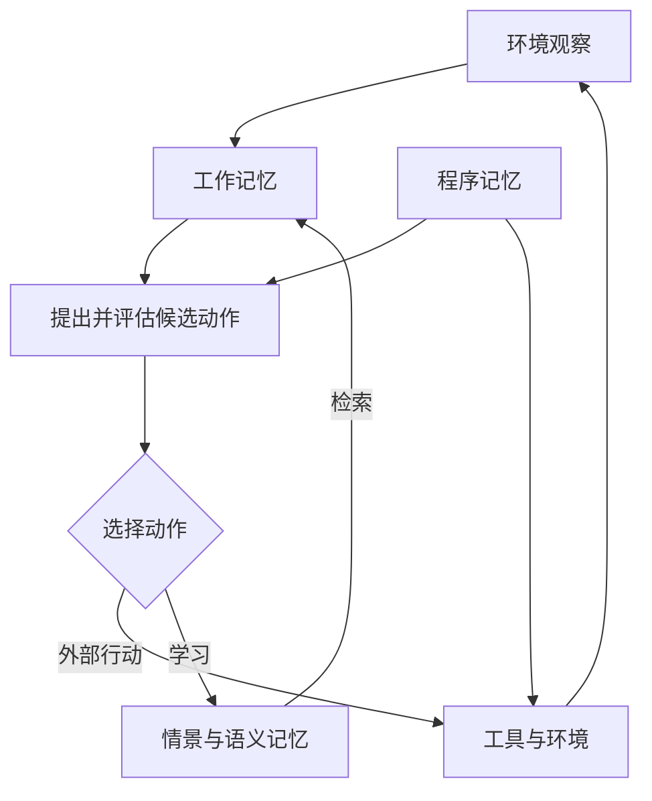

# CoALA：语言智能体的认知架构

> 把工作记忆、经历、知识和技能放到统一的决策框架中。

**英文题名**：Cognitive Architectures for Language Agents  
**发表／版本**：2023 预印本；2024 TMLR  
**原文入口**：[主文](https://openreview.net/forum?id=1i6ZCvflQJ) · [arXiv](https://arxiv.org/abs/2309.02427)  
**本篇阅读依据**：下列原文正文  
**更新日期**：2026-10-23

---

## 1. 为什么需要一种 Agent 的“共同架构语言”

有的 Agent 被描述为“模型加工具”，有的说自己有规划器、记忆库和反思器。这些模块名称相近，实际作用却可能完全不同。CoALA 希望建立统一描述：一个语言 Agent 怎样保存信息、怎样思考、怎样行动，以及怎样在经历中改变自己。

它借鉴认知科学与传统认知架构，把 Agent 放进“记忆—行动—决策”的关系中。贡献主要是概念框架和组织已有工作的方式，不是发布一个能在所有任务上胜出的新 Agent。[1，§1、§4]

## 2. 用“办公桌、档案柜和工具箱”理解四种记忆

### 工作记忆：当前正在处理的材料

办公桌上有任务目标、刚收到的观察、已检索的资料、下一步计划。工作记忆是这些活跃信息的汇合点。它可以由 prompt、程序变量和结构化状态共同实现，不必等同于聊天记录全文。

### 情景记忆：过去发生过什么

例如“昨天排查实例 A，发现连接池等待时间上升”。它带有具体场景与过程，相当于经历档案。检索旧经历，可以帮助比较当前问题，也可以为后续总结提供证据。

### 语义记忆：关于世界和自身的知识

例如“连接池耗尽会使请求排队”。它更像从经历或外部资料中获得的一般认识。这里的 semantic 不是说必须存成语义向量，而是在区分“某次事件”与“较一般的知识”。

### 程序记忆：怎样做，以及用什么机制做

包括可执行代码、工具操作过程与 Agent 自身控制代码；论文也把 LLM 参数中隐含的程序性能力纳入这个视角。因而程序记忆不只是后来新学会的几个函数，还包括让 Agent 能启动并决策的既有能力。[1，§4.1]

| 同一个排障任务 | 对应记忆 |
| --- | --- |
| 现在需要解释的告警和当前指标 | 工作记忆 |
| 上次的执行步骤和观测 | 情景记忆 |
| 关于数据库瓶颈的知识 | 语义记忆 |
| 调用监控接口的代码和决策过程 | 程序记忆 |

## 3. 为什么要区分内部动作与外部动作

调用数据库 API 会改变可观察的外部状态，属于外部动作；把一段历史拿进当前上下文，或从历史中总结规律，则是内部处理。CoALA 把内部动作进一步区分为检索、推理和学习。

**检索**从长期记忆中读取已有内容；**推理**处理工作记忆，形成新的候选解释或计划；**学习**将信息写入长期记忆。三者不是同义词：找到旧结论不等于重新推理，在脑中得到一个判断也不代表已经把它长期保存。[1，§4.2–§4.5]

这一划分解释了一个常见现象：Agent 本轮分析得很好，下轮又重复犯错。它完成了推理，却没有把可复用结果写入长期记忆，或者下一轮没有正确检索。

## 4. 决策循环怎样运行

论文把决策描述为反复发生的循环。Agent 根据观察和工作记忆提出候选动作，通过推理与检索评估，选出要执行的外部动作或学习动作，再接收后续观察。

这里的规划并不必然是一个独立的大模型。它可以由代码规定先后顺序，也可以让 LLM 生成和比较候选方案。框架允许不同实现，重要的是把控制流说清楚。[1，§4.6]

## 5. 它怎样解释已有系统

Generative Agents 保存观察，反思后产生较一般的认识，再用这些内容规划行为。在 CoALA 语言里，这是情景记忆、语义记忆和推理／学习动作的配合。

Voyager 生成并验证操作程序，把成功程序加入技能库。它不仅积累事件，也在扩充可用的程序记忆。下次任务调用旧技能，是用过去形成的能力支持当前行动。

两种系统都在“学习”，但改变的对象不同。前者突出对经历的理解，后者突出可执行行为的积累。CoALA 的价值，就是把这种差异清楚地暴露出来，而不是把它们都压成“有长期记忆”。[1，§5]

## 6. 一个完整的教学例子

假设数据库 Agent 收到“接口超时”的告警。工作记忆保存当前目标、限制和指标。它从情景记忆找出上次类似故障，从语义记忆读取可能原因，再调用程序记忆中已有的查询工具。

查询显示 CPU 不高、连接等待增加。推理阶段把“算力不足”和“连接池耗尽”作为候选解释，比较证据后选择继续查看连接来源。任务结束，执行轨迹写入情景记忆；若形成一般经验，则另存为语义记忆。如果新建了一个诊断脚本，还涉及程序记忆的更新。

注意，最后三种写入可以有不同权限。自动记录一次观测较容易；修改通用知识需要证据；发布以后会执行的新代码则需要验证。CoALA 的分类有助于解释为什么不能用一个没有区别的“save memory”覆盖所有行为。

## 7. 论文怎样论证自身价值

它不是通过“CoALA 分数高于某基线”来证明架构，而是回顾传统认知系统、给出现有语言 Agent 的统一映射，并据此讨论设计选择和未来研究。

因此，评估这篇论文的重点是框架是否清晰、能否区分真实的设计差异、能否帮助发现缺失环节。它没有保证使用四种记忆就一定更强，也没有要求每个系统都同时实现完整的四类可写模块。

## 8. 总结

CoALA 把记忆从一个附加数据库，放回 Agent 的整体行为中：工作记忆承接当前状态，长期记忆提供经历、知识与能力，内部动作处理这些内容，决策循环把它们转化为外部行动。

最重要的理解是：记忆的价值取决于它怎样参与决策；学习既可能改变外部知识，也可能改变代码或模型能力。

## 9. 我的看法

我认为 CoALA 对架构设计的价值高于对单个检索算法的价值。它能让团队在讨论“增加记忆”之前，先确认增加的是事件存储、知识总结、技能复用，还是上下文调度。这能避免职责混乱。

但认知分类不是物理部署图。四种记忆完全可以共享一个可靠存储层，也可以分布在多个系统中。把“四类记忆”机械实现成“四套数据库”，往往只增加运维负担。

如果用它指导实际项目，我会先画清当前状态、知识来源、工具执行和长期写入之间的关系，再明确哪些写入需要校验。对于长期运行的 Agent，最值得追问的是：它本轮学到的东西，下轮到底通过哪条路径影响行动？如果这条路径讲不通，记忆库建得再大也没有意义。

---

## 原文与引用

[1] [本文详细解析依据的正文](https://arxiv.org/pdf/2309.02427)。正文中的章节与表格编号以此版本为准。

[2] [主文／正式发表入口](https://openreview.net/forum?id=1i6ZCvflQJ)。

文中的教学案例用于解释机制；“我的看法”是独立分析。实验数字为作者报告，本仓库未独立复现。

[返回研究索引](../README.md) · [横向对比](../guides/comparison.md) · [版本说明](../guides/source-verification.md)
