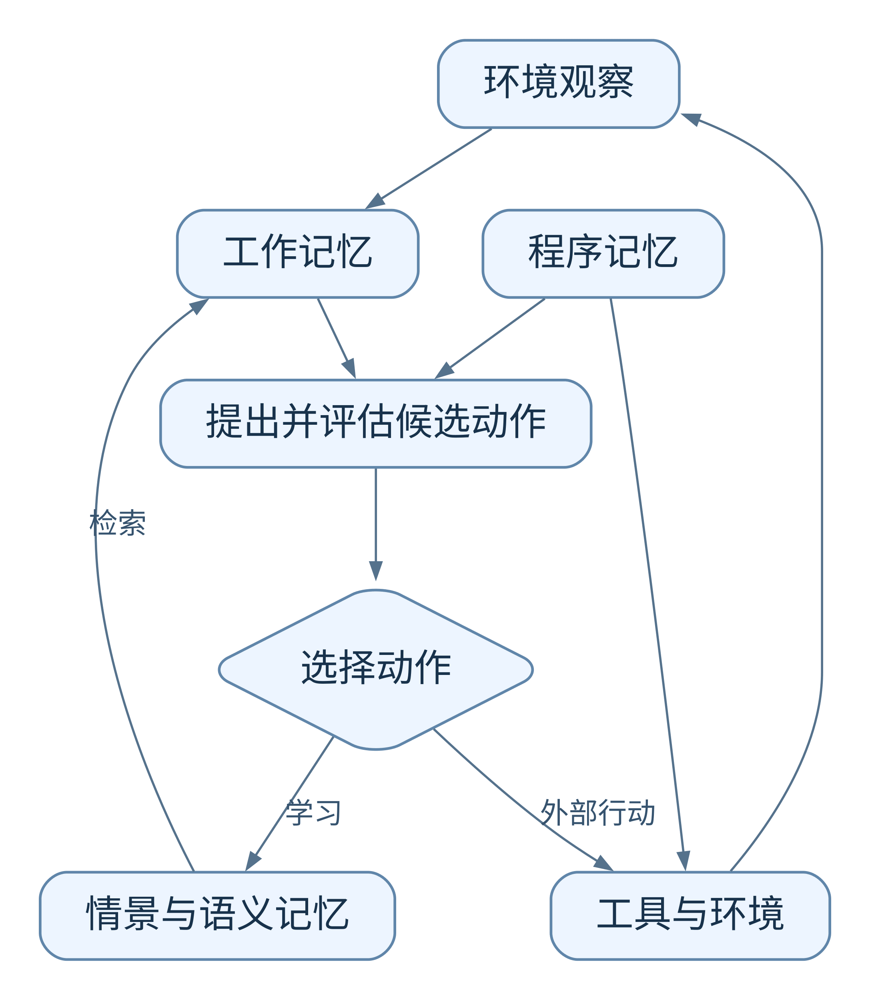

# CoALA：语言智能体的认知架构

**阅读建议：了解即可** · [查看分级依据与阅读顺序](../README.md#priorities)

读清工作记忆、长期记忆与决策循环之间的关系即可。试着把自己熟悉的 Agent 放进框架，说明一次检索或学习发生在哪里；不必从这篇概念框架中寻找可直接复现的性能提升。

> 把工作记忆、经历、知识和技能放到统一的决策框架中。

**英文题名**：Cognitive Architectures for Language Agents  
**发表／版本**：2023 预印本；2024 TMLR  
**原文入口**：[主文](https://openreview.net/forum?id=1i6ZCvflQJ) · [arXiv](https://arxiv.org/abs/2309.02427)  
**本篇阅读依据**：下列原文正文  
**更新日期**：2026-10-27

---

## 阅读导航

- [1. 为什么需要一种 Agent 的“共同架构语言”](#s1)
- [2. 用“办公桌、档案柜和工具箱”理解四种记忆](#s2)
- [3. 为什么要区分内部动作与外部动作](#s3)
- [4. 决策循环怎样运行](#s4)
- [5. 它怎样解释已有系统](#s5)
- [6. 一个完整的教学例子](#s6)
- [7. 决策循环中，候选动作怎样变成实际动作](#s7)
- [8. 同一段内容，可以在不同位置承担不同职责](#s8)
- [9. 框架能帮助发现什么，不能替你决定什么](#s9)
- [10. 论文怎样论证自身价值](#s10)
- [项目实现与数据](#implementation)
- [11. 总结与看法](#s11)

## 1. 为什么需要一种 Agent 的“共同架构语言”

有的 Agent 被描述为“模型加工具”，有的说自己有规划器、记忆库和反思器。这些模块名称相近，实际作用却可能完全不同。CoALA 希望建立统一描述：一个语言 Agent 怎样保存信息、怎样思考、怎样行动，以及怎样在经历中改变自己。

它借鉴认知科学与传统认知架构，把 Agent 放进“记忆—行动—决策”的关系中。贡献主要是概念框架和组织已有工作的方式，不是发布一个能在所有任务上胜出的新 Agent。[1，§1、§4]

## 2. 用“办公桌、档案柜和工具箱”理解四种记忆

### 工作记忆：当前正在处理的材料

办公桌上有任务目标、刚收到的观察、已检索的资料、下一步计划。工作记忆是这些活跃信息的汇合点。它可以由 prompt、程序变量和结构化状态共同实现，不必等同于聊天记录全文。

### 情景记忆：过去发生过什么

例如“昨天排查实例 A，发现连接池等待时间上升”。它带有具体场景与过程，相当于经历档案。检索旧经历，可以帮助比较当前问题，也可以为后续总结提供证据。

### 语义记忆：关于世界和自身的知识

例如“连接池耗尽会使请求排队”。它更像从经历或外部资料中获得的一般认识。这里的 semantic 不是说必须存成语义向量，而是在区分“某次事件”与“较一般的知识”。

### 程序记忆：怎样做，以及用什么机制做

包括可执行代码、工具操作过程与 Agent 自身控制代码；论文也把 LLM 参数中隐含的程序性能力纳入这个视角。因而程序记忆不只是后来新学会的几个函数，还包括让 Agent 能启动并决策的既有能力。[1，§4.1]

| 同一个排障任务 | 对应记忆 |
| --- | --- |
| 现在需要解释的告警和当前指标 | 工作记忆 |
| 上次的执行步骤和观测 | 情景记忆 |
| 关于数据库瓶颈的知识 | 语义记忆 |
| 调用监控接口的代码和决策过程 | 程序记忆 |

## 3. 为什么要区分内部动作与外部动作

调用数据库 API 会改变可观察的外部状态，属于外部动作；把一段历史拿进当前上下文，或从历史中总结规律，则是内部处理。CoALA 把内部动作进一步区分为检索、推理和学习。

**检索**从长期记忆中读取已有内容；**推理**处理工作记忆，形成新的候选解释或计划；**学习**将信息写入长期记忆。三者不是同义词：找到旧结论不等于重新推理，在脑中得到一个判断也不代表已经把它长期保存。[1，§4.2–§4.5]

这一划分解释了一个常见现象：Agent 本轮分析得很好，下轮又重复犯错。它完成了推理，却没有把可复用结果写入长期记忆，或者下一轮没有正确检索。

## 4. 决策循环怎样运行

论文把决策描述为反复发生的循环。Agent 根据观察和工作记忆提出候选动作，通过推理与检索评估，选出要执行的外部动作或学习动作，再接收后续观察。

  

[查看图源](../assets/diagrams/02-coala.mmd)

这里的规划并不必然是一个独立的大模型。它可以由代码规定先后顺序，也可以让 LLM 生成和比较候选方案。框架允许不同实现，重要的是把控制流说清楚。[1，§4.6]

## 5. 它怎样解释已有系统

Generative Agents 保存观察，反思后产生较一般的认识，再用这些内容规划行为。在 CoALA 语言里，这是情景记忆、语义记忆和推理／学习动作的配合。

Voyager 生成并验证操作程序，把成功程序加入技能库。它不仅积累事件，也在扩充可用的程序记忆。下次任务调用旧技能，是用过去形成的能力支持当前行动。

两种系统都在“学习”，但改变的对象不同。前者突出对经历的理解，后者突出可执行行为的积累。CoALA 的价值，就是把这种差异清楚地暴露出来，而不是把它们都压成“有长期记忆”。[1，§5]

## 6. 一个完整的教学例子

假设数据库 Agent 收到“接口超时”的告警。工作记忆保存当前目标、限制和指标。它从情景记忆找出上次类似故障，从语义记忆读取可能原因，再调用程序记忆中已有的查询工具。

查询显示 CPU 不高、连接等待增加。推理阶段把“算力不足”和“连接池耗尽”作为候选解释，比较证据后选择继续查看连接来源。任务结束，执行轨迹写入情景记忆；若形成一般经验，则另存为语义记忆。如果新建了一个诊断脚本，还涉及程序记忆的更新。

注意，最后三种写入可以有不同权限。自动记录一次观测较容易；修改通用知识需要证据；发布以后会执行的新代码则需要验证。CoALA 的分类有助于解释为什么不能用一个没有区别的“save memory”覆盖所有行为。

## 7. 决策循环中，候选动作怎样变成实际动作

CoALA 把决策分为提出候选、评估候选与选择动作。它描述的是这些职责及其可使用的信息，不规定必须有三个 LLM，也没有给出一个对所有任务通用的打分公式。[1，§4.6]

沿用排障例子，当前观察是“响应时间升高”。工作记忆还保存“只能进行只读诊断”。可以提出“查连接数”“查锁等待”“重启实例”等候选，但三个名称本身没有告诉系统该选谁。

| 环节 | 这个例子中发生什么 | 改变了什么 |
| :--- | :--- | :--- |
| 提出候选 | 依据告警生成可调查方向 | 工作记忆中多了备选操作 |
| 检索 | 找回上次相似故障与相关限制 | 当前可用证据增加 |
| 推理与评估 | 结合指标判断锁等待更值得查；排除不符合限制的操作 | 候选的可行性与优先级改变 |
| 选择并执行 | 调用只读锁等待接口 | 得到新的外部观察 |
| 再次决策 | 新结果显示没有锁等待，改查连接来源 | 下一轮候选改变 |

这里检查限制和选择接口是教学实现，不是论文自带的数据库策略。真实系统可以用规则排除非法候选，用模型排序可行候选，也可以用搜索方法比较多步计划。CoALA 都能描述，但不会替你选定其中一种。

一次检索也不等于决策循环必须结束。Agent 可以先检索，再推理，发现证据不足后继续检索，直到选择外部行动或学习动作。如果把经过验证的排障步骤写入长期记忆，改变的是后续任务可用的知识；如果只在本轮形成了想法，任务结束后未保存，就没有发生这种长期变化。

读这部分最有用的检查是：候选从哪里产生，评估用了什么证据，选择由什么规则执行。仅画出“观察→思考→行动”三个框，还没有说明一个可运行 Agent 的决策机制。

## 8. 同一段内容，可以在不同位置承担不同职责

“遇到超时先检查排队”最初可能来自某次事故，是情景记忆的一部分。多次事故支持它之后，系统把它提炼为一般诊断知识，便具有语义记忆的角色。如果进一步写成诊断函数并加入工具库，又涉及程序记忆。被取出来处理眼前告警时，它同时进入工作记忆。

因此，四类记忆不是互斥的文件格式。同一个经历可以形成多种表示，各自服务不同的决策阶段。判断其类别，要看内容和用途，而不能只看它是否存于文本、向量或代码文件中。

程序记忆尤其容易被低估。Agent 使用哪些工具、怎样解析调用、何时停止，这些控制能力在任务开始前就已经存在于代码或模型中。新增技能只是程序记忆可以改变的一部分。只统计新保存的函数，会漏掉整个 Agent 赖以运行的既有机制。[1，§4.1]

## 9. 框架能帮助发现什么，不能替你决定什么

假设一个系统只有历史检索和回答生成。用 CoALA 描述时，可以清楚看到它有长期资料读取，却未必有任务完成后的经验写入。另一个系统会在失败后修改提示，但关闭进程就丢失这些修改，它具有尝试内适应，却缺少稳定的跨任务积累。

这些区别影响系统能否持续改进，但 CoALA 不替我们决定数据库、向量模型、压缩率或事务边界。它也不要求所有 Agent 都拥有可修改的程序记忆。一个仅用于查资料的助手，可能只需要可靠的检索与阅读。

我会把这套框架用于设计评审：先让团队说清每种状态在哪里、谁能修改、什么时候读取，再讨论具体产品和算法。这样，“我们还缺一个记忆模块”就能变成“任务完成后没有保存可迁移经验”这种可以实施的改动。

## 10. 论文怎样论证自身价值

它不是通过“CoALA 分数高于某基线”来证明架构，而是回顾传统认知系统、给出现有语言 Agent 的统一映射，并据此讨论设计选择和未来研究。

因此，评估这篇论文的重点是框架是否清晰、能否区分真实的设计差异、能否帮助发现缺失环节。它没有保证使用四种记忆就一定更强，也没有要求每个系统都同时实现完整的四类可写模块。

## 项目实现与数据

> 实现与资源核查：2026-10-24。下面区分论文实验与后续项目演进；本节完成了资源与源码核查，未重新运行作者实验。

### 官方资源是一份架构索引

作者维护的 [awesome-language-agents](https://github.com/ysymyth/awesome-language-agents)按 CoALA 的框架整理语言智能体，提供架构图、论文列表和 `CoALA.bib`。它没有提供名为 CoALA 的统一运行时，也没有定义一份所有 Agent 共用的训练数据。

因此，“用 CoALA 实现 Agent”通常意味着按它的框架设计系统。网上名称相似的代码分析工具、其他研究的 Coala 或第三方示例，不能自动算作这篇论文的官方实现。

### 从分类对应到可读的代码

可以结合本库已有的三个项目理解 CoALA：

| CoALA 中的概念 | 可以观察的项目 | 在实现里看什么 |
| :--- | :--- | :--- |
| 经历经过归纳，形成新的知识 | Generative Agents | 事件如何进入记忆，反思如何留下新认识 |
| 失败经历影响下一次决策 | Reflexion | 反馈如何变成反思，并进入下一轮提示 |
| 经验沉淀为程序能力 | Voyager | 成功代码如何保存、检索并组合使用 |

这张表是按 CoALA 做的教学映射，不表示三个项目依赖某个 CoALA 软件包。实现时也不必为每种记忆建一套数据库。重要的是把读取和写入的时机讲清楚：一条经验何时产生，哪个决策会读取它，它究竟改变了候选动作还是最终执行。

如果要验证自己的架构，可以记录一轮决策的输入状态、检索证据、候选动作、最终动作和新增记忆，再检查下一轮是否实际使用了新增内容。这是把概念框架转成可观察行为的一种方法，属于本篇建议，并非作者发布的基准。

## 11. 总结与看法

CoALA 的贡献是统一描述，不是一个新的记忆检索器。它把当前状态、过去经历、一般知识和可执行能力放进同一个决策过程，让“增加记忆”变成可以明确职责的设计讨论。

我认为最有用的区分是检索、推理和学习：取回旧信息，形成当前判断，改变长期状态，三者可以连在一起，却不是同一件事。很多 Agent 当场想明白了，下次仍犯错，正是因为没有形成可靠的写回与再读取路径。

但分类不提供实现效果的保证。一个系统即使具备所有类别，也可能候选生成糟糕、评估不准、执行错误；四种记忆也不要求四套数据库。架构名称与物理部署不应机械对应。

这篇了解核心框架即可。读完能够把自己的执行流程说清，并指出哪一步真的改变长期状态，已经获得主要价值；检索排序、更新算法和成本取舍，应继续读具体方法论文。

---

## 原文与引用

[1] [本文详细解析依据的正文](https://arxiv.org/pdf/2309.02427)。正文中的章节与表格编号以此版本为准。

[2] [主文／正式发表入口](https://openreview.net/forum?id=1i6ZCvflQJ)。

文中的自拟案例、演算与伪代码用于解释方法；工程建议和结尾评论属于独立分析。实验数字为作者报告，本仓库未独立复现。

[返回研究索引](../README.md) · [横向对比](../guides/comparison.md) · [版本说明](../guides/source-verification.md)

[← 上一篇](01-memory-survey.md) · [返回总目录](../README.md) · [下一篇 →](03-generative-agents.md)
