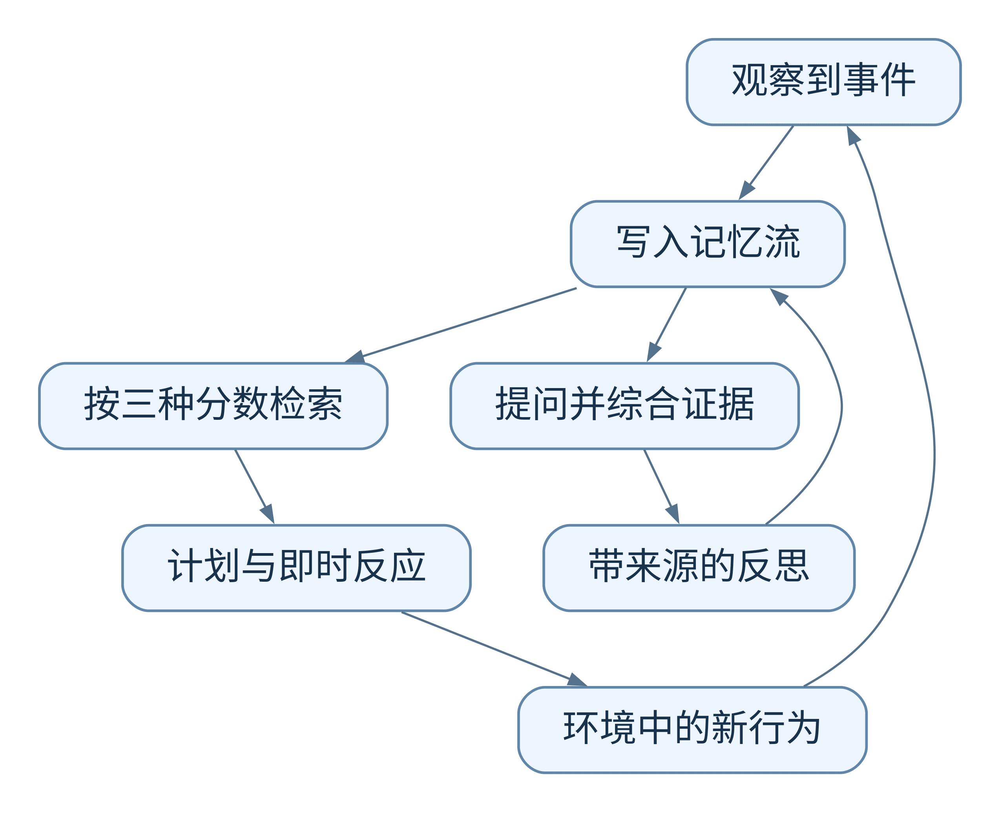

# Generative Agents：生成式智能体：人类行为的交互式模拟

**阅读建议：了解即可** · [查看分级依据与阅读顺序](../README.md#priorities)

抓住经历记录、检索、反思和计划怎样接起来。重点区分原始事件与生成的高层认识，并看评估中的行为可信度如何定义；模拟人物表现自然，不能直接推导出事实记忆可靠。

> 记录经历、总结高层认识，再用相关记忆指导计划与行为。

**英文题名**：Generative Agents: Interactive Simulacra of Human Behavior  
**发表／版本**：2023  
**原文入口**：[主文](https://arxiv.org/abs/2304.03442) · [arXiv](https://arxiv.org/abs/2304.03442)  
**本篇阅读依据**：下列原文正文  
**更新日期**：2026-10-24

---

## 阅读导航

- [1. 从“每轮像个人”到“连续生活像同一个人”](#s1)
- [2. 记忆流保存的是什么](#s2)
- [3. 检索为什么同时看三个分数](#s3)
- [4. 反思怎样从记录变成认识](#s4)
- [5. 计划怎样把记忆变成行动](#s5)
- [6. 用一次邀请看检索、反思和计划怎样接力](#s6)
- [7. 反思为什么先生成问题，再寻找证据](#s7)
- [8. 计划怎样避免“答应了却没去”](#s8)
- [9. 派对为什么能成为完整示例](#s9)
- [10. 实验如何评价“像不像一个连续的人”](#s10)
- [11. 怎样迁移到其他场景](#s11)
- [项目实现与数据](#implementation)
- [12. 总结与看法](#s12)

## 1. 从“每轮像个人”到“连续生活像同一个人”

单次对话中，大模型很容易扮演一个咖啡店老板。但如果模拟持续两天，它可能忘记邀请过谁、今天准备做什么，也可能每次见到邻居都像初次认识。问题不只是语言是否自然，而是行为能否与经历保持连续。

Generative Agents 在 Smallville 小镇中放入 25 个 Agent，让它们生活、交谈、交友并协调活动。核心设计有三部分：记录经历，从经历形成反思，用相关记忆制定和调整计划。[1，§3–§4]

## 2. 记忆流保存的是什么

最基础的记忆是观察：看到某人学习、与邻居交谈、发现冰箱空了。每个记忆对象包含自然语言描述、创建时间和最近访问时间。记忆流持续增长，成为角色经历的记录。

作者并不把所有记录压成一段总摘要。总摘要容易只保留笼统印象，丢掉能够回答具体问题的细节。系统选择在需要行动或回答时，从完整记忆流中挑选当前相关的内容。[1，§4.1]

## 3. 检索为什么同时看三个分数

### 相关性：这条经历和现在的问题有多接近

系统通过文本向量衡量当前情况与记忆描述的接近程度。问派对时，过去的邀请、准备和对话应该优先于不相关的早餐记录。

### 重要性：这是不是值得记住的大事

同样新发生的事情，“刷牙”和“收到录取通知”的意义不同。作者让语言模型对记忆的重要程度打分。这个分数反映角色层面的事件重要性，而不是一个确定的真实性判定。

### 最近访问程度：这件事是否仍在注意范围内

作者根据距上次访问的游戏时间做指数衰减，实验使用的衰减因子为 0.995。注意它与“创建时间新不新”并不完全一样：旧事件如果刚被想起，也可能再次进入注意中心。

三个分数归一化后加权相加：

$$
S(m)=\alpha_r R(m)+\alpha_i I(m)+\alpha_t T(m)
$$

论文实现中三个权重都设为 1，再选择能放入上下文的高分记忆。直观上，这相当于同时考虑“相关、重要、最近想过”，而非只看措辞是否相似。[1，§4.1]

## 4. 反思怎样从记录变成认识

假设一个学生经常看研究书、与别人讨论研究、花很多时间写论文。单条观察不能直接回答“他最在意什么”；综合起来，则能形成“他很投入研究”的认识。

论文用一个逐步过程生成反思：当近期事件的重要性累计超过阈值时触发；先根据最近记忆提出值得思考的高层问题；以这些问题检索相关经历；再让模型提炼认识并引用支持它的记录。实现中的触发阈值是 150，反思大约每天发生两三次。

反思也会重新进入记忆流。后续反思还能利用旧反思，于是形成树：底部是观测，上层是越来越抽象的认识。论文保存支持关系，说明认识来自哪些记忆。[1，§4.2]

这一步很重要，也有风险：越高层的结论越简洁，却越可能离原始条件更远。一个偶然事件若被过度概括，可能影响角色很长时间。

## 5. 计划怎样把记忆变成行动

如果每分钟都独立问模型“接下来做什么”，它可能反复吃早餐或频繁改变方向。论文先根据角色特点与经历生成较粗的日程，再逐步细化到具体时间和行为。

执行过程中会接收新的观察。系统判断是否需要反应，如果需要，就修改后续安排。例如原本准备学习，但遇到朋友询问派对，可以先交流，再返回原有任务。计划负责保持连续，反应机制负责适应变化。[1，§4.3]

  

[查看图源](../assets/diagrams/03-generative-agents.mmd)

## 6. 用一次邀请看检索、反思和计划怎样接力

设想角色刚听到朋友邀请自己参加派对。记忆流先保存这次交流，包括时间、人物与活动安排。下一步是否参加，需要的不只是邀请本身：角色还可能检索自己的日程、与邀请者的关系、之前对活动的态度。

假设两条候选记忆归一化后的分数如下。这些数值只是演算，沿用论文三项权重均为 1 的设置。

| 记忆 | 相关性 | 重要性 | 最近访问程度 | 合计 |
| --- | ---: | ---: | ---: | ---: |
| 昨天答应帮朋友布置派对 | 0.9 | 0.8 | 0.6 | 2.3 |
| 刚刚吃完早餐 | 0.2 | 0.1 | 1.0 | 1.3 |

早餐虽然更新近，但承诺更相关、更重要，因此更容易被选中。若只按时间窗口保留最近内容，旧承诺反而可能消失。反过来，一件很重要但与当前任务无关的事，也不一定应当占据全部上下文。

指数衰减项可以理解为  $T=0.995^{\Delta t}$ ，其中时间间隔按论文的游戏时间单位计算。它控制的是访问优先级；不会因为某个事件分数下降，就自动判定事件不再真实。再次检索会更新最近访问时间，这使被频繁想起的事情持续保持活跃。[1，§4.1]

## 7. 反思为什么先生成问题，再寻找证据

直接要求“总结最近经历”，容易得到流水账。论文先从最近 100 条记录中提出三个高层问题，例如“我和谁关系最亲近”“我最近最投入什么”。随后围绕问题检索相关记录，生成若干洞见；具体实现中要求五条洞见，并附支持记录的编号。[1，§4.2]

这个顺序值得留意：问题先确定抽象方向，检索再收集证据，最后生成认识。反思并不是把最近 100 条文字直接缩短。某个高层问题所需的材料可能来自更早的历史，也可能包含先前生成的反思。

例如，角色多次与同一朋友交谈、一起准备活动，系统可能归纳“我愿意花时间帮助这位朋友”。这条认识随后影响计划。但如果支持记录只包含一次偶然帮忙，结论就可能过强。保存来源编号使这种推断至少有机会被追查。

## 8. 计划怎样避免“答应了却没去”

从“我愿意参加”到真正到场，中间还需要把活动放进日程、在合适时间结束当前任务、选择地点并移动。论文先生成较粗的安排，再逐步细化到更短时间段的动作；新观察到来时，系统判断是否中断和修改后续计划。[1，§4.3]

这解释了派对实验中的一个现象：知道活动、接受邀请和到场是三个不同结果。记忆检索只保证相关信息可能被想起，计划和执行还可能失效。

读消融结果时也应注意作者的控制方法。访谈比较让不同版本访问截至同一时刻积累的记忆，避免重新模拟后角色经历完全不同，难以比较。[1，§6] 这样更适合检查在相似历史下各模块对回答的作用；它并不直接等价于移除某模块后重新运行两天会产生怎样的社会行为。作者对这一点也有说明。

## 9. 派对为什么能成为完整示例

作者只给一个角色注入“想举办情人节派对”的意图。之后，邀请通过日常交谈传播，角色逐渐知道活动，安排时间并参与准备。系统没有为每一对角色写死传播脚本。

这并不意味着每个人都成功参加。论文记录：消息传播到 13 个角色；12 个被邀请者中有 5 个最终到场。没有到场的角色有的存在安排冲突，有的虽然表示想参加，却没有形成当天的行动计划。[1，§7.1]

这个失败部分反而说明记忆、意图和执行不能画等号。“知道派对”不代表“记得安排参加”，更不代表“最后一定到达”。

## 10. 实验如何评价“像不像一个连续的人”

作者用访谈问题考察角色自我认识、记忆、计划、反应与反思，并让人比较回答的可信程度；还移除反思、计划和记忆，观察变化。

在其 TrueSkill 评估中，完整架构均值为 29.89，无反思版本为 26.88，无反思与计划版本为 25.64，完整移除相关能力的版本为 21.21。这些是特定比较程序中的评分，不是问答准确率，更不能解释为“29.89% 的人类智能”。[1，§6.5]

实验支持三个模块都有价值，但也发现回忆时添枝加叶、错误选择地点、对他人建议过度迎合等问题。语言连贯与事实可靠仍有距离。

## 11. 怎样迁移到其他场景

以下是教学延伸。数据库 Agent 可以保存原始事件，从多次事件中总结排查认识，再据此形成诊断计划。但“现象总结”与“根因确定”必须分开：多次故障与批处理同时发生，最多先支持关联，不能直接证明因果。

还应区分原始事件、推导出的认识和待执行计划。这样错误结论被修正时，才知道哪些后续推断和计划受到影响。这是从论文设计引出的工程判断，不是作者已经验证的数据库实现。

## 项目实现与数据

> 实现与资源核查：2026-10-24。下面区分论文实验与后续项目演进；本节完成了资源与源码核查，未重新运行作者实验。

### 从小镇画面找到真正的 Agent 逻辑

[官方仓库](https://github.com/joonspk-research/generative_agents)同时包含模拟环境和认知模块。画面负责呈现角色的位置与动作；角色为什么去某处、想起什么、怎样安排一天，主要由后端决定。阅读时可以从 [persona.py](https://github.com/joonspk-research/generative_agents/blob/main/reverie/backend_server/persona/persona.py)进入，再顺着 `cognitive_modules` 与 `memory_structures` 阅读。

`Persona` 把感知、检索、计划、反思和执行连接起来。这里的“执行”最后会变成下一步地图坐标、动作描述等环境可用信息。因此，模型生成一句“我要去咖啡馆”还只是计划的一部分，模拟器必须继续把它落实到小镇中的位置和对象。

### 数据是角色的经历与模拟状态

仓库提供 25 人和 3 人的基础场景，也提供角色初始历史 CSV。CSV 中的历史会被装入相应角色的记忆流；运行后保存的模拟位于 `environment/frontend_server/storage`，用于演示的压缩结果位于 `compressed_storage`。这些是合成角色设定、环境状态和运行记录，不是真实用户聊天训练集。

例如，给 Isabella 写入“计划举办派对”的历史后，应依次观察她的计划、她与别人交谈时的内容、其他角色收到的信息，以及这些角色后来的行动。只看最后有没有人到场，很难区分是邀请没有传播、没有被想起，还是临时计划发生变化。

### 怎样开始阅读与复现

可以先回放仓库中的既有演示，理解时间步与角色状态，再用三人场景生成一小段新模拟。回放读取已有结果，重新模拟则会调用模型产生新决定，两者不能作为同一种实验。

复现时需保存初始角色历史、场景副本、模型配置和运行步数。换一个模型后即使小镇仍能运行，也可能产生不同社交行为。对这篇论文而言，最有价值的产物是可追踪的行为链：从哪条经历出发，经由哪次检索或反思，影响了哪次行动。

## 12. 总结与看法

这篇论文把长期行为连续性拆成了可理解的机制：记忆流保存经历，组合分数决定想起什么，反思把多条经历变成认识，计划把认识落实到行动。它的重要性不只是“25 个角色的小镇演示”，而是展示了完整的信息到行为的循环。

我认为最值得借鉴的是“反思保留证据”和“计划与反应并存”。前者让抽象认识有来处，后者避免 Agent 每一步都推倒重来。这比单纯增加向量库更接近长期运行系统真正需要的能力。

但它的目标主要是行为可信，而不是事实系统的严格正确。重要性分数、反思阈值和日程策略都与模拟环境相关，不适合原样迁移。对于严肃业务，我会保留它的结构，重新设计可信度、时间有效性与约束执行机制。

它也提醒我们：记忆好不等于行动一定成功。派对没有全部到场，不只是“忘记了”这么简单，还涉及计划和环境。评价 Agent 时，必须把记住、理解、安排和完成分别检查。

---

## 原文与引用

[1] [本文详细解析依据的正文](https://arxiv.org/html/2304.03442)。正文中的章节与表格编号以此版本为准。

[2] [主文／正式发表入口](https://arxiv.org/abs/2304.03442)。

文中的自拟案例、演算与伪代码用于解释方法；工程建议和结尾评论属于独立分析。实验数字为作者报告，本仓库未独立复现。

[返回研究索引](../README.md) · [横向对比](../guides/comparison.md) · [版本说明](../guides/source-verification.md)

[← 上一篇](02-coala.md) · [返回总目录](../README.md) · [下一篇 →](04-reflexion.md)
