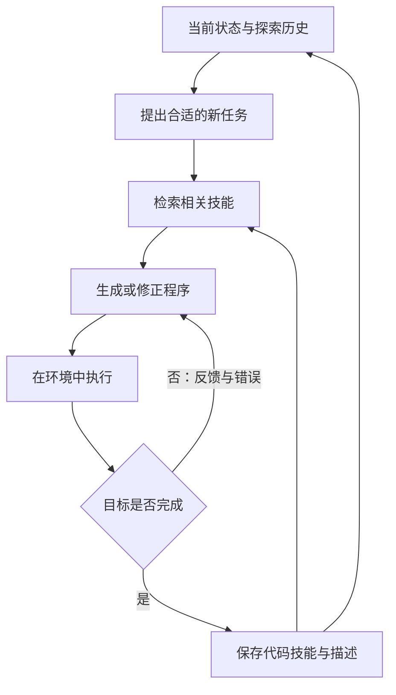

# Voyager：基于大语言模型的开放式具身智能体

> 把做成功的操作保存为代码技能，后续检索、组合并复用。

**英文题名**：Voyager: An Open-Ended Embodied Agent with Large Language Models  
**发表／版本**：2023 预印本  
**原文入口**：[主文](https://arxiv.org/abs/2305.16291) · [arXiv](https://arxiv.org/abs/2305.16291)  
**本篇阅读依据**：下列原文正文  
**更新日期**：2026-10-23

---

## 1. 为什么它要研究一个没有固定终点的游戏

传统任务常给出明确目标，例如找到物品或走到终点。但开放世界中，Agent 还要决定下一步学什么，并把已学能力积累起来。Minecraft 很适合检验这件事：木头、石头、铁、钻石形成技能和资源依赖，复杂任务需要组合基础能力。

Voyager 不只是回答“怎样玩”，而是生成代码、在环境中执行、根据反馈修正，再把成功程序保存为以后可调用的技能。三个关键组件是自动课程、技能库与迭代提示。[1，§2]

## 2. 自动课程怎样决定下一步

如果刚进入世界就要求挖钻石，目标可能超过当前资源与能力；如果永远只捡木头，又无法持续成长。自动课程要在“足够新颖”和“当前可完成”之间选择。

论文把背包、装备、附近方块与生物、地形、生命值、位置以及完成／失败任务提供给 GPT-4，请它提出下一项适当挑战。还有辅助的问答过程补充相关背景。它不是固定顺序的任务清单，而是结合实时状态提出目标。[1，§2.1]

直观地说，系统先看“我现在有什么、会什么、周围有什么”，再决定“接下来学哪一招”。

## 3. 技能为什么用代码保存

文字笔记可以说“先做镐，再去挖矿”，但实际执行时仍要重新翻译成一串动作。代码技能把动作序列封装成可以调用的程序，还能被更复杂程序组合。

例如，取得木材的技能可以成为制作工具的一部分；制作工具又是采矿技能的一部分。技能复用让后来的任务建立在已有能力上，避免每次从最小动作重新生成。

论文中的技能库用程序描述的 embedding 作为检索键，用程序本身作为值。描述由模型生成，检索时结合任务建议和环境反馈找出相关技能，文中使用 top-5 候选。[1，§2.2]

这里学习的主要成果存放在技能库中，不要求微调 GPT-4。模型本身没变，可调用的能力集合却增加了。

## 4. 程序怎样从“生成了”变成“学会了”

Voyager 不把第一版代码直接永久收录，而是循环执行并修改。提示中包含控制 API、已检索技能、当前状态、上轮代码和反馈。

作者区分三种反馈：环境反馈告诉你发生了什么；执行错误告诉你程序在哪里出问题；自验证判断当前结果是否已经满足目标。它们分别回答“世界变成怎样”“代码有没有错”“任务是否完成”。程序能运行，不代表任务已完成，因此第三类反馈不能省略。[1，§2.3]

## 5. 用一个具体任务理解组合效应

以下是对论文机制的教学化演绎。新任务是获取铁矿。系统检索已有的采集木材、制作基础工具、寻找指定方块等技能；模型生成新的采矿程序；执行后发现镐的等级不足，于是修正工具准备过程。

任务成功后，保存的是能够复用的采铁程序及其描述。以后要制作铁装备时，可以把这个技能作为组成部分，而不是再次发现同样的工具限制。

这就像一个开发者逐渐积累函数库。成长不只来自“记得上次做过”，还来自“下次有现成能力可以调用”。

## 6. 实验究竟测了什么

作者关注物品发现、技术树进展、地图探索和新世界中的任务泛化。报告在 160 次提示迭代内发现 63 种独特物品，约为所比较方法的 3.3 倍；探索距离约为 2.3 倍。技术树实验也比较达到木、石、铁、钻石层级所需的提示迭代。[1，§3.3]

这里的“更快”主要按提示迭代衡量，不是统一硬件上的每秒性能。实验运行次数和环境分布也应一起阅读，不能解释为任意开放世界都能获得相同比例提升。

作者还把学到的技能用于新的 Minecraft 世界，测试能否帮助完成新任务。这比只在原地重复执行更能说明可复用性，但仍受限于相同游戏和工具接口。

## 7. 消融比总体数字更有解释力

论文分别移除自动课程、技能库、环境反馈、执行错误、自验证，并替换代码生成模型。

- 用随机课程代替自动课程，发现物品数下降约 93%，说明目标选择决定了成长路径是否合理。
- 没有技能库时，后期更容易停滞，说明复用基础能力对复杂任务重要。
- 移除自验证后，发现物品数下降约 73%，说明 Agent 必须知道什么时候继续尝试、什么时候转向下一目标。

这些结果支持的是组件配合，而不是“任何加一个向量技能库的 Agent 都能持续学习”。[1，§3.4]

## 8. 它与 Reflexion 有什么本质差别

Reflexion 主要保存改进决策的文字教训；Voyager 保存能执行的程序。前者更像错题本，后者更像函数库。一个说明应该怎样想，一个提供已经形成的行为模块。

自动课程也是重要区别：Voyager 需要自己选择学习目标，而不是只把外部给定任务重试到成功。因此它对“持续成长”的研究同时覆盖了目标选择、技能形成与能力复用。

## 9. 局限与适用范围

代码生成质量仍依赖基础模型，技能也依赖环境 API 与状态假设。某段程序在一个场景成功，不代表在资源不足、位置变化或版本不同的场景都能工作。论文使用结构化环境信息，并不能被直接理解为解决了真实世界感知。

面向生产业务，还要额外处理权限、参数校验、执行前置条件和旧技能失效。这些是迁移时必须补上的机制，不是原实验已经覆盖的能力。

## 10. 总结

Voyager 展示了另一种重要记忆：可执行的程序能力。自动课程提出合适挑战，迭代反馈把代码修到可用，技能库让成果被检索和组合，形成越来越有用的能力积累。

## 11. 我的看法

我认为它最重要的启发是“记忆可以保存做事能力”，不只保存知识和对话。对于运维或开发 Agent，一个被验证过、带清楚输入输出的工具封装，可能比很多自然语言摘要更有价值。

但我不会直接让成功一次的代码进入长期可执行库。成功往往只证明某次状态下有效，还需要把环境假设、依赖和失败条件显式化。真正可靠的技能记忆，应当像软件组件一样有版本、测试和撤回机制。

另一个值得重视的点是课程。若后续任务与已有能力毫无联系，再好的记忆也难以体现积累价值。因此评价“持续改进”时，任务序列的设计和技能复用路径，应该和技能数量一样受到重视。

---

## 原文与引用

[1] [本文详细解析依据的正文](https://arxiv.org/html/2305.16291)。正文中的章节与表格编号以此版本为准。

[2] [主文／正式发表入口](https://arxiv.org/abs/2305.16291)。

文中的教学案例用于解释机制；“我的看法”是独立分析。实验数字为作者报告，本仓库未独立复现。

[返回研究索引](../README.md) · [横向对比](../guides/comparison.md) · [版本说明](../guides/source-verification.md)
