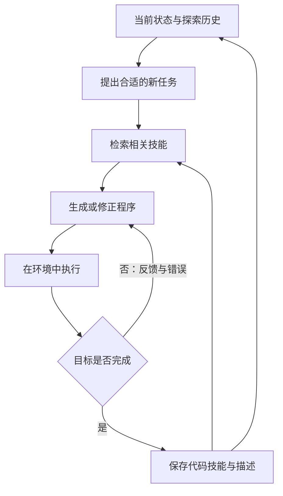

# Voyager：基于大语言模型的开放式具身智能体

> 把做成功的操作保存为代码技能，后续检索、组合并复用。

**英文题名**：Voyager: An Open-Ended Embodied Agent with Large Language Models  
**发表／版本**：2023 预印本  
**原文入口**：[主文](https://arxiv.org/abs/2305.16291) · [arXiv](https://arxiv.org/abs/2305.16291)  
**本篇阅读依据**：下列原文正文  
**更新日期**：2026-10-24

---

## 阅读导航

- [1. 为什么它要研究一个没有固定终点的游戏](#s1)
- [2. 自动课程怎样决定下一步](#s2)
- [3. 技能为什么用代码保存](#s3)
- [4. 程序怎样从“生成了”变成“学会了”](#s4)
- [5. 用一个具体任务理解组合效应](#s5)
- [6. 技能库里保存的是怎样一种能力](#s6)
- [7. 三类反馈怎样指向不同修正](#s7)
- [8. 怎样看待开放式探索的实验结果](#s8)
- [9. 实验究竟测了什么](#s9)
- [10. 消融比总体数字更有解释力](#s10)
- [11. 它与 Reflexion 有什么本质差别](#s11)
- [12. 局限与适用范围](#s12)
- [项目实现与数据](#implementation)
- [13. 总结与看法](#s13)

## 1. 为什么它要研究一个没有固定终点的游戏

传统任务常给出明确目标，例如找到物品或走到终点。但开放世界中，Agent 还要决定下一步学什么，并把已学能力积累起来。Minecraft 很适合检验这件事：木头、石头、铁、钻石形成技能和资源依赖，复杂任务需要组合基础能力。

Voyager 不只是回答“怎样玩”，而是生成代码、在环境中执行、根据反馈修正，再把成功程序保存为以后可调用的技能。三个关键组件是自动课程、技能库与迭代提示。[1，§2]

## 2. 自动课程怎样决定下一步

如果刚进入世界就要求挖钻石，目标可能超过当前资源与能力；如果永远只捡木头，又无法持续成长。自动课程要在“足够新颖”和“当前可完成”之间选择。

论文把背包、装备、附近方块与生物、地形、生命值、位置以及完成／失败任务提供给 GPT-4，请它提出下一项适当挑战。还有辅助的问答过程补充相关背景。它不是固定顺序的任务清单，而是结合实时状态提出目标。[1，§2.1]

直观地说，系统先看“我现在有什么、会什么、周围有什么”，再决定“接下来学哪一招”。

## 3. 技能为什么用代码保存

文字笔记可以说“先做镐，再去挖矿”，但实际执行时仍要重新翻译成一串动作。代码技能把动作序列封装成可以调用的程序，还能被更复杂程序组合。

例如，取得木材的技能可以成为制作工具的一部分；制作工具又是采矿技能的一部分。技能复用让后来的任务建立在已有能力上，避免每次从最小动作重新生成。

论文中的技能库用程序描述的 embedding 作为检索键，用程序本身作为值。描述由模型生成，检索时结合任务建议和环境反馈找出相关技能，文中使用 top-5 候选。[1，§2.2]

这里学习的主要成果存放在技能库中，不要求微调 GPT-4。模型本身没变，可调用的能力集合却增加了。

## 4. 程序怎样从“生成了”变成“学会了”

Voyager 不把第一版代码直接永久收录，而是循环执行并修改。提示中包含控制 API、已检索技能、当前状态、上轮代码和反馈。

作者区分三种反馈：环境反馈告诉你发生了什么；执行错误告诉你程序在哪里出问题；自验证判断当前结果是否已经满足目标。它们分别回答“世界变成怎样”“代码有没有错”“任务是否完成”。程序能运行，不代表任务已完成，因此第三类反馈不能省略。[1，§2.3]

## 5. 用一个具体任务理解组合效应

以下是对论文机制的教学化演绎。新任务是获取铁矿。系统检索已有的采集木材、制作基础工具、寻找指定方块等技能；模型生成新的采矿程序；执行后发现镐的等级不足，于是修正工具准备过程。

任务成功后，保存的是能够复用的采铁程序及其描述。以后要制作铁装备时，可以把这个技能作为组成部分，而不是再次发现同样的工具限制。

这就像一个开发者逐渐积累函数库。成长不只来自“记得上次做过”，还来自“下次有现成能力可以调用”。

## 6. 技能库里保存的是怎样一种能力

技能条目可以分成两部分：描述用于让系统找到它，程序用于执行。描述如果写得过泛，相关任务找不到合适技能；程序如果依赖没有声明的环境前提，即使检索正确也可能失败。[1，§2.2]

例如一段“获取铁矿”的代码可能默认已有石镐。如果描述只写“采矿”，后续任务在工具不足时也会把它取出来。模型仍需要结合背包、装备和当前环境决定怎样调用，技能库并没有消除所有规划。

技能被检索后，会作为生成程序的参考或可调用组成部分进入提示。复杂能力可以由已有技能组合，但组合仍需通过环境验证。几个函数各自成功，不代表它们在新的资源与位置条件下连用就一定成功。

## 7. 三类反馈怎样指向不同修正

获取铁矿时，“函数不存在”“背包没有铁矿”“附近没有可采矿块”看似都是失败，实际要求不同修改。

| 反馈 | 更可能的问题 | 下一步可能的调整 |
| --- | --- | --- |
| API 调用异常 | 代码与接口不匹配 | 修改参数或调用方式 |
| 程序执行完但背包无目标物品 | 目标没有真正完成 | 检查采集结果与任务条件 |
| 当前地点没有合适资源 | 环境不满足前提 | 先探索或改变行动路线 |

Voyager 将环境反馈、执行错误和自验证结果都带入下一轮代码生成。[1，§2.3] 这样修正可以针对具体失败，而不只是重新采样一段程序。自验证的价值在于区分“代码没有抛异常”和“任务已经完成”；它的风险则是模型可能误解环境状态。

自动课程也参与这个循环。如果当前缺少必要资源，系统可以先选择较容易、但能解锁后续能力的任务。课程决定接下来学什么，迭代提示解决怎样学会，技能库保存学会的结果。三者少了任何一部分，长期探索都容易退化：目标太难、反复失败，或每次重新发现同一套做法。

## 8. 怎样看待开放式探索的实验结果

独特物品数衡量探索覆盖面，达到某级工具衡量技能依赖是否被突破，探索距离衡量活动范围。这些指标相互补充：走得很远却没有获得新能力，和稳定推进技术树，是不同的进展。

论文的消融中，随机课程下物品发现大幅减少；移除自验证也明显伤害表现。[1，§3] 这些结果支持“任务选择”和“完成判断”对探索的重要性。它们并没有证明每一条代码技能都能在任意新环境复用。

迁移到新世界时，游戏规则和工具接口大体保持一致，地形与资源位置发生变化。这个设置检验了技能对环境变化的适应，而不是跨游戏、跨机器人平台的通用迁移。

如果把这个思路用于软件或运维 Agent，我会首先区分一次性修复脚本和可复用技能。后者应说明前置条件、输入输出和失败处理，并经过新的情境验证。Voyager 给出了让程序积累成能力的路径；能否长期维护这套能力，还取决于接口变化和旧技能失效后如何处理。

## 9. 实验究竟测了什么

作者关注物品发现、技术树进展、地图探索和新世界中的任务泛化。报告在 160 次提示迭代内发现 63 种独特物品，约为所比较方法的 3.3 倍；探索距离约为 2.3 倍。技术树实验也比较达到木、石、铁、钻石层级所需的提示迭代。[1，§3.3]

这里的“更快”主要按提示迭代衡量，不是统一硬件上的每秒性能。实验运行次数和环境分布也应一起阅读，不能解释为任意开放世界都能获得相同比例提升。

作者还把学到的技能用于新的 Minecraft 世界，测试能否帮助完成新任务。这比只在原地重复执行更能说明可复用性，但仍受限于相同游戏和工具接口。

## 10. 消融比总体数字更有解释力

论文分别移除自动课程、技能库、环境反馈、执行错误、自验证，并替换代码生成模型。

- 用随机课程代替自动课程，发现物品数下降约 93%，说明目标选择决定了成长路径是否合理。
- 没有技能库时，后期更容易停滞，说明复用基础能力对复杂任务重要。
- 移除自验证后，发现物品数下降约 73%，说明 Agent 必须知道什么时候继续尝试、什么时候转向下一目标。

这些结果支持的是组件配合，而不是“任何加一个向量技能库的 Agent 都能持续学习”。[1，§3.4]

## 11. 它与 Reflexion 有什么本质差别

Reflexion 主要保存改进决策的文字教训；Voyager 保存能执行的程序。前者更像错题本，后者更像函数库。一个说明应该怎样想，一个提供已经形成的行为模块。

自动课程也是重要区别：Voyager 需要自己选择学习目标，而不是只把外部给定任务重试到成功。因此它对“持续成长”的研究同时覆盖了目标选择、技能形成与能力复用。

## 12. 局限与适用范围

代码生成质量仍依赖基础模型，技能也依赖环境 API 与状态假设。某段程序在一个场景成功，不代表在资源不足、位置变化或版本不同的场景都能工作。论文使用结构化环境信息，并不能被直接理解为解决了真实世界感知。

面向生产业务，还要额外处理权限、参数校验、执行前置条件和旧技能失效。这些是迁移时必须补上的机制，不是原实验已经覆盖的能力。

## 项目实现与数据

> 实现与资源核查：2026-10-24。下面区分论文实验与后续项目演进；本节完成了资源与源码核查，未重新运行作者实验。

### Python 决策，JavaScript 控制游戏

[官方项目 MineDojo/Voyager](https://github.com/MineDojo/Voyager)需要 Minecraft 环境，并结合 Python 侧的模型决策与 Node.js／Mineflayer 侧的游戏操作。`voyager/agents` 中的课程、动作、评价和技能模块，对应论文里的任务选择、程序改进和技能复用。只安装 Python 包还不能重现完整探索过程，还需按仓库说明配置游戏实例与模组。

### 技能库到底存了什么

[SkillManager 的实现](https://github.com/MineDojo/Voyager/blob/main/voyager/agents/skill.py)把技能分成两份互相对应的内容：自然语言描述用于相似检索，程序代码用于后续生成与执行。`skills.json` 保存名称到代码、描述的映射，`skill/code` 和 `skill/description` 分别保留文件，向量库以技能名称关联这些内容。

所以，当任务是“做一把铁镐”时，检索命中的是描述上相关的技能，返回给模型的则包括实际程序。向量并不是技能本身，它只是帮助找到程序的入口。代码还会检查向量库条目数与技能映射数是否一致，说明程序和索引的对应关系在实验实现中也需要维护。

### 公开的数据与建议实验

仓库的 [skill_library](https://github.com/MineDojo/Voyager/tree/main/skill_library)提供学得的技能库，README 说明了如何加载它进行任务分解与推理，也说明了学习检查点的恢复方法。这些可执行技能和探索记录是主要研究产物；Voyager 并不要求先用一份“Voyager 训练集”微调 GPT-4。

一个容易理解的对照是：在相同新世界与任务条件下，分别使用空技能库和已有技能库，记录生成了多少新代码、执行失败几次、用了多少模型调用。恢复原学习进度与向新世界迁移技能是两种不同实验；官方示例也将检查点目录与已有技能库目录分开，避免新运行的记录覆盖学习成果。

## 13. 总结与看法

Voyager 展示了另一种重要记忆：可执行的程序能力。自动课程提出合适挑战，迭代反馈把代码修到可用，技能库让成果被检索和组合，形成越来越有用的能力积累。

这对运维或开发 Agent 尤其有启发：一个被验证过、带清楚输入输出的工具封装，可能比很多自然语言摘要更有价值。

但我不会直接让成功一次的代码进入长期可执行库。成功往往只证明某次状态下有效，还需要把环境假设、依赖和失败条件显式化。真正可靠的技能记忆，应当像软件组件一样有版本、测试和撤回机制。

另一个值得重视的点是课程。若后续任务与已有能力毫无联系，再好的记忆也难以体现积累价值。因此评价“持续改进”时，任务序列的设计和技能复用路径，应该和技能数量一样受到重视。

---

## 原文与引用

[1] [本文详细解析依据的正文](https://arxiv.org/html/2305.16291)。正文中的章节与表格编号以此版本为准。

[2] [主文／正式发表入口](https://arxiv.org/abs/2305.16291)。

文中的自拟案例、演算与伪代码用于解释方法；工程建议和结尾评论属于独立分析。实验数字为作者报告，本仓库未独立复现。

[返回研究索引](../README.md) · [横向对比](../guides/comparison.md) · [版本说明](../guides/source-verification.md)

[← 上一篇](04-reflexion.md) · [返回总目录](../README.md) · [下一篇 →](06-memorybank.md)
