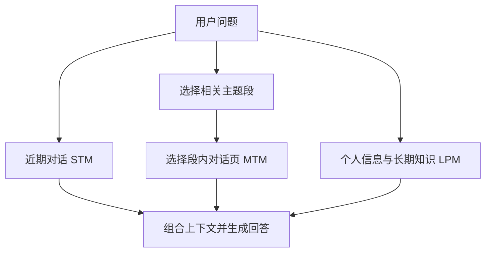

# MemoryOS：AI 智能体的记忆操作系统

> 用短期、中期和长期个人记忆管理近期上下文、主题内容与稳定画像。

**英文题名**：Memory OS of AI Agent  
**发表／版本**：2025 EMNLP  
**原文入口**：[主文](https://aclanthology.org/2025.emnlp-main.1318/) · [arXiv](https://arxiv.org/abs/2506.06326)  
**本篇阅读依据**：arXiv v1；正式版汇总数字不与技术稿混用  
**更新日期**：2026-10-24

---

## 阅读导航

- [1. 它为什么要把记忆分成三层](#s1)
- [2. 短期记忆：保留当前对话的连续性](#s2)
- [3. 中期记忆：按主题组织段和页](#s3)
- [4. 热度怎样决定保留与晋升](#s4)
- [5. 长期个人记忆到底存哪些东西](#s5)
- [6. 一次回答怎样合并三层](#s6)
- [7. 一个贯穿示例](#s7)
- [8. 页从短期进入中期时，哪些上下文必须一起走](#s8)
- [9. 热度更新怎样改变记忆的去留](#s9)
- [10. 三层材料冲突时，回答需要读懂什么](#s10)
- [11. 实验与成本如何阅读](#s11)
- [12. 总结与看法](#s12)

## 1. 它为什么要把记忆分成三层

长期聊天中有三种不同需求：马上接住刚说的话，找到以前某个主题的细节，以及长期了解用户和助手的特点。若全部平铺，相关内容难以组织；若只剩一段摘要，细节又容易丢失。

MemoryOS 借鉴操作系统的层次与分段分页思想，设计短期记忆 STM、中期记忆 MTM、长期个人记忆 LPM，并安排存储、更新、检索和生成四个模块。[1，§3]

这些层次是逻辑组织，不是要求把一层放内存、一层放 SSD、一层放对象存储。论文研究的是信息管理策略，而不是新的通用操作系统。

## 2. 短期记忆：保留当前对话的连续性

STM 以对话页保存问题、回答、时间和上下文链信息。一个 page 可以理解为一次交互及其背景说明。

为什么还要有链信息？因为“这个可以，但不要改第二项”脱离前文就没有意义。论文让模型判断新对话与之前内容是否连续，并形成链的摘要，尽量在页面转移后保留必要上下文。

STM 使用固定长度队列。新页进入后，如果容量已满，较旧页面按 FIFO 转入 MTM。论文技术稿的实验配置中，STM 容量为 7。这个数是实验参数，不是人类短期记忆容量在软件中的严格映射。[1，§3.2–§3.3]

## 3. 中期记忆：按主题组织段和页

MTM 把相关对话页组织成主题段 segment。可以把段理解为一个项目文件夹，页是其中某次沟通。

例如“旅行安排”“数据库排障”“学习计划”分别属于不同主题。相同主题后来再次出现时，可以继续与已有内容关联。主题组织有助于先判断应该翻哪个文件夹，再读里面哪些页面。

这个设计同时保留主题概览和较具体对话，避免只剩标签或只剩零散片段。论文使用语义与相关性策略完成组织，页面如何分组本身也会影响后面的召回。[1，§3.2]

## 4. 热度怎样决定保留与晋升

论文给主题段定义热度：

$$
H=\alpha N_{visit}+\beta L_{interaction}+\gamma R_{recency},\qquad R_{recency}=e^{-\Delta t/\mu}
$$

检索次数多，说明常被访问；对话页多，说明围绕它有较多交互；刚被访问，则时间衰减项较高。三者共同反映使用活跃度。

当中期容量超限，低热度段会被淘汰；高于阈值的主题内容则用于更新长期个人信息。论文技术稿设置的晋升阈值为 5，并在转移后重置部分交互计数，让主题后续仍需新的证据支持继续晋升。[1，§3.3]

这里的热度不是可信度。一个被频繁讨论的错误认识也可能很热，因此需要把“值得常用”和“已经证实”区分开。这一点是本文的分析。

## 5. 长期个人记忆到底存哪些东西

LPM 包含用户画像、用户特征、用户知识及助手相关信息。技术稿中的用户特征采用多维度结构，另外的知识或助手事实集合也有容量管理。

这体现了个人长期记忆与主题历史的不同：主题页告诉你用户在某次任务里说过什么；长期特征用于让后续交互保持个性化。但“从对话推断的特点”与“用户明确设定的偏好”仍应分清，不能因为进入长期层就变成不可修改真相。

## 6. 一次回答怎样合并三层

STM 贡献当前上下文；MTM 先选相关主题段，再在段内选相关页；LPM 提供与问题相关的知识和个人信息，最后组合成 prompt 生成回答。[1，§3.4–§3.5]

两阶段检索的好处是缩小搜索范围，也有风险：第一阶段如果选错主题，第二阶段就根本看不到正确页面。因此主题组织不是单纯的展示优化，而会改变召回能力。

## 7. 一个贯穿示例

用户最近讨论某次告警，STM 保存当前调查进度；过去两周围绕同一实例的记录组织在 MTM；用户长期要求“回答先给结论、命令注明执行环境”，进入 LPM。

新问题“这次和上周有什么不同”到来时，系统既需要最近指标，也需要主题历史，还要遵从输出偏好。三类信息共同生成回答。如果只查用户画像，根本没有事件细节；如果只查旧日志，又可能不知道本轮已完成哪些检查。这个例子用于解释机制，并非论文的数据库实验。

## 8. 页从短期进入中期时，哪些上下文必须一起走

一个对话页里可能只有“第二种更合适”。如果它离开 STM 时没有带走前面的方案信息，MTM 保存得再久也无法解释“第二种”是什么。论文使用对话链信息补充这种关联，目的就是让转移后的页仍能被理解。[1，§3.2–§3.3]

以部署讨论为例，连续对话提出单地域和多地域两种方案，用户随后选择单地域。转入中期时，页面需要保留选择对象及当时的约束。若只留下用户最后一句，检索得到的只是一个没有指向的决定；若每页都复制全部对话，容量又会迅速增长。

主题段提供了一个折中：相关页保留在同一主题范围内，段级信息帮助概览，页级内容提供细节。但主题分组也需要处理变化。相同实例的容量规划和故障排查既有关联，又不完全相同，过粗会引入噪声，过细会拆断线索。

## 9. 热度更新怎样改变记忆的去留

热度由访问次数、交互量和近期程度共同组成。用一组自拟数值演算，令三个权重均为 1：主题 A 的访问项为 3、交互项为 2、近期项为 0.8，总分为 5.8；主题 B 为 1、1、0.9，总分为 2.9。A 虽然没有 B 更新近，仍因反复讨论而更热。

超过晋升阈值后，主题内容用于更新长期个人记忆。[1，§3.3] 这里的晋升更接近从经历中提取个人信息，不是把所有历史字节机械搬到另一个存储设备。主题的交互计数还会调整，避免旧积累持续触发同样处理。

这条规则适合识别反复出现的兴趣和主题，却无法独自解决语义有效性。例如用户经常抱怨某个产品，热度高并不表示喜欢它；一次明确更正，也不应因访问少而被忽略。热度帮助分配注意力，个人特征仍须从具体内容判断。

## 10. 三层材料冲突时，回答需要读懂什么

STM 里可能出现“这次请详细解释”，LPM 则保存“用户通常喜欢简洁回答”。两者并不一定矛盾：一个是本次要求，一个是通常偏好。组合上下文之后，生成模型需要保留这种作用范围。

再比如 MTM 记着旧项目采用方案 A，STM 刚确认改为 B。回答“过去为什么用 A”应使用历史，回答“现在用什么”应使用新状态。把所有较旧内容统一删除，或把所有长期内容视为更权威，都会出错。

论文的层次结构让这些材料有机会一起进入回答，具体冲突处理仍依赖内容理解。工程上我会显式携带来源时间和适用范围，并用“近期纠正能否覆盖长期误解”做专门测试。

评价分层机制时，也应分开关闭主题段、长期画像和热度策略，观察各类问题与维护成本的变化。近期指代题可能主要受 STM 影响，个人偏好题更依赖 LPM；只看整体 F1，很难知道哪个层次真正提供了价值。

## 11. 实验与成本如何阅读

技术稿在 GVD 与 LoCoMo 上比较记忆与回答表现，并进行模块消融。效率表同时给出召回 token、平均模型调用和 F1：MemoryOS 为 3,874 token、4.9 次调用、36.23 F1；A-Mem* 为 2,712 token、13.0 次调用、26.55 F1；MemGPT 为 16,977 token、4.3 次调用、29.13 F1。[1，Table 3]

这些结果很有启发：MemoryOS 并非每个成本指标都最小，它在该设置下取得了不同的成本与质量平衡。不能把“调用少于 A-Mem”进一步说成“调用少于所有方法”。

本篇方法与上述表格依据早期技术稿。正式 EMNLP 版摘要中的部分汇总数字有调整，因此这里不把不同版本的相对提升混用。[2]

## 12. 总结与看法

MemoryOS 的主要内容是把对话管理分成近期连续性、主题历史和长期个人理解，再通过对话链、分段分页、热度与多层检索连接起来。它让记忆管理从一条平铺列表变成有组织的生命周期。

我认为“主题段与对话页并存”比操作系统的名称更值得关注。它提供了一个中间尺度：既不像原子事实那么碎，也不像整场会话那么宽，适合持续反复讨论的项目和主题。

但层级越多，错误传播和管理成本也越多。主题划分错误、晋升过早、画像推断过度，都可能让后续回答偏离原始事实。我会把晋升理解为增加一种派生表示，而不是抹去原始记录。

实际选择时，我倾向先证明分层检索对目标业务有收益，再引入复杂热度机制。热度适合优化访问，事实有效期和用户更正则应该有更明确的规则。两者一起使用，比让热度决定所有长期保留更可靠。

---

## 原文与引用

[1] [本文详细解析依据的正文](https://arxiv.org/html/2506.06326v1)。正文中的章节与表格编号以此版本为准。

[2] [主文／正式发表入口](https://aclanthology.org/2025.emnlp-main.1318/)。

文中的自拟案例、演算与伪代码用于解释方法；工程建议和结尾评论属于独立分析。实验数字为作者报告，本仓库未独立复现。

[返回研究索引](../README.md) · [横向对比](../guides/comparison.md) · [版本说明](../guides/source-verification.md)

[← 上一篇](07-longmemeval.md) · [返回总目录](../README.md) · [下一篇 →](09-mem0.md)
