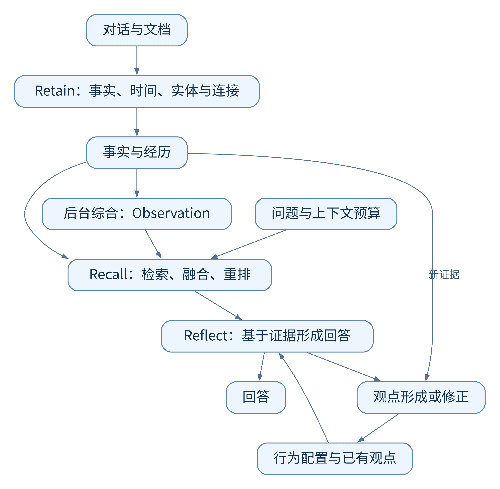

# Hindsight 精读：让 Agent 分清事实、经历、观察与观点

> **独立教程 · Hindsight**  
> 同一个项目聊了几个月，助手还能说清哪些决定变了、为什么变，以及现在该怎么办吗？Hindsight 尝试用一套结构化记忆回答这个问题。

| 阅读信息 | 内容 |
| :--- | :--- |
| 主论文 | **Hindsight: Structured Agent Memory that Retains, Recalls, and Reflects** |
| 作者 | Chris Latimer、Nicolò Boschi、Andrew Neeser、Chris Bartholomew、Gaurav Srivastava、Xuan Wang、Naren Ramakrishnan |
| 正式发表 | ACL 2026 System Demonstrations，pp. 275–285 |
| 正式版原文 | [论文页面](https://aclanthology.org/2026.acl-demo.27/) · [PDF](https://aclanthology.org/2026.acl-demo.27.pdf) |
| 方法补充 | [Hindsight is 20/20: Building Agent Memory that Retains, Recalls, and Reflects，arXiv:2512.12818v1](https://arxiv.org/html/2512.12818v1) |
| 阅读前提 | 一般编程知识；不要求熟悉知识图谱、向量检索或 Agent Memory |
| 修订日期 | 2026-10-24 |
| 本文边界 | 解释论文及必要附录；不代表当前产品、SDK 或主干源码的逐项审计 |

**版本约定。** 下文以 **[D]** 指正式演示论文，以 **[T]** 指上述固定版本的长技术稿。方法公式主要来自 [T]，正式版新增的工具循环与观察证据结构另行标注。两份稿件在概念和接口上有些差异，相关处会分别说明。为便于理解，文中另编了 Atlas 项目案例及数值演算，伪代码也只用于解释流程。

## 阅读导航

- [1. 问题起点：保存了聊天记录，为什么还会记错](#s1)
- [2. 必要概念：记忆库、向量、实体、图与证据](#s2)
- [3. 四类记忆：信息为什么需要分层](#s3)
- [4. 整体架构：三个操作如何配合](#s4)
- [5. Retain：把对话变成可使用的记忆](#s5)
- [6. 时间、实体与四类连接](#s6)
- [7. Observation：从事实积累到实体认识](#s7)
- [8. Recall：四条检索路径](#s8)
- [9. 融合、重排与预算](#s9)
- [10. Reflect：基于证据回答与调整观点](#s10)
- [11. 完整案例：跨会话回忆与观点修正](#s11)
- [12. 实验精读：高分背后的比较条件](#s12)
- [13. 局限：哪些问题仍然存在](#s13)
- [14. 我的工程推演](#s14)
- [项目实现与数据](#implementation)
- [15. 总结与看法](#s15)
- [来源与继续阅读](#sources)

<a id="s1"></a>

## 1. 问题起点：保存了聊天记录，为什么还会记错

先看一个例子。你正在和数据库助手讨论 Atlas 检索服务的上线，几次对话相隔了半个月。

| 会话 | 当时说了什么 | 后续可能需要的内容 |
| :--- | :--- | :--- |
| 4 月 3 日 | “Atlas 检索服务计划 4 月 20 日上线，目前还没做故障切换测试。”助手建议先测切换 | 目标日期、成熟度、助手提出过的建议 |
| 4 月 10 日 | “昨天的切换测试发现缓存恢复过慢，因此把上线推迟到 5 月 6 日。” | 故障发生时间、延期原因、新计划 |
| 4 月 18 日 | “缓存恢复已经修好，单地域切换复测通过；跨地域切换还没测，上线目标仍是 5 月 6 日。” | 已解决的问题、仍存在的风险、当前计划 |

4 月 21 日，你问：“我们为什么没有按最初的日期上线？目前能直接全量发布吗？”要回答前半句，助手得找回原定日期和延期原因；要回答后半句，它还得知道后来修好了什么、哪些测试仍没做。单独找到某次聊天，往往不够。

如果把整段历史塞给模型，它需要在无关话题中自己辨认时间和版本，历史越长越容易遗漏。如果只做向量检索，问题可能命中“上线”和“全量发布”，却漏掉措辞不同的“缓存恢复过慢”。如果只保留最新摘要，又可能只剩“计划 5 月 6 日上线”，丢掉延期过程。

还有一种隐蔽错误：助手曾说“我认为目前不宜全量发布”，下一轮却把这句话当作用户已经批准的限制。**一句模型判断经过保存和再次检索，可能被误当成外部事实。** 数据存下来了，但身份和依据丢失了。

Hindsight 试图让信息带着类型、时间、实体和关联进入记忆，让检索沿不同线索寻找证据，并让回答与观点变化使用这些证据。[T §1、§3] 贯穿这套设计的一个问题是：助手说出一句话时，能否分清它来自用户原话、自己的行动记录，还是后来形成的判断？

<a id="s2"></a>

## 2. 必要概念：记忆库、向量、实体、图与证据

**Memory bank，记忆库。** 可以理解成有独立身份的记忆空间，保存某个 Agent 或场景的长期信息及行为配置。四类记忆组织在同一 bank 内。应用可以按用户、项目等组织 bank，具体映射和权限由业务设计。

**Embedding，向量表示。** 模型把文本转换为一串数字，希望意思接近的文本在向量空间中更近。因此“服务恢复花了很久”和“恢复耗时过高”可能互相命中。但相似只表示表达或主题接近，不表示事情真实，也不证明它们是同一个事件。

**Entity，实体。** 是被反复提到的人、项目、产品等对象。“Atlas 服务”“那个检索项目”可能指向同一项目，另一部门也可能有同名项目。把不同提法连到正确对象叫实体解析或消歧。它既要避免同一对象被拆散，也要避免不同对象被误合并。

**Graph，图。** 用节点和连接表示关系。这里可把记忆看成节点，把“提到同一项目”“发生时间接近”“前一事件促成后一决定”看成连接。有了这些连接，系统找到一条线索后，就能继续查与它有关的记录。

**Evidence，证据。** 是支持陈述的来源。摘要若说“Atlas 已完成故障切换验证”，应能回查原始记录，才能发现原文其实只验证了单地域切换。向量、图、摘要都是组织和访问手段，关键判断仍需要来源支持。

还要区分模型参数与外部记忆。这里主要改变模型每次看到的材料及外部持久状态，不是每次对话后重新训练模型权重。Agent 表现出“记住了”，可能只是下次回答前检索到了之前保存的内容。

<a id="s3"></a>

## 3. 四类记忆：信息为什么需要分层

作者按信息的性质划分了四个逻辑网络，可以放在同一套数据库中。[D §3.1；T §3.1]

| 类型 | 回答的问题 | Atlas 教学案例 | 必须保留的边界 |
| :--- | :--- | :--- | :--- |
| **World** | 外部环境发生了什么，谁陈述了什么？ | 用户报告 4 月 9 日发现缓存恢复过慢 | 用户陈述可能未经独立核验 |
| **Experience** | Agent 自己做过什么？ | 助手建议先做切换测试 | 建议不代表已经执行 |
| **Observation** | 综合材料，对对象有什么认识？ | 目标日期改为 5 月 6 日，单地域复测通过，跨地域未验证 | 派生归纳可能遗漏条件或滞后 |
| **Opinion** | Agent 基于证据形成了什么判断？ | 我倾向先灰度发布，暂不建议跨地域全量切换 | 判断带立场与置信度，不是既定事实 |

### 3.1 World 与 Experience：谁在行动

“用户说已经测试过”与“助手调用工具执行了测试”不同。前者记录外部陈述，后者记录助手行为。把用户行为写成助手经历，可能导致后续错误宣称“我验证过”。“我建议增加监控”也只能证明提出过建议，不能证明监控已经部署。参与者和动作归属，比一句简洁总结更关键。

### 3.2 Observation 与 Opinion：归纳还是评价

Observation 尽量不受行为偏好影响；Opinion 可以表达带立场的评价。“近两次复测通过”是证据归纳，“因此这个团队执行力很强”加入了评价。**偏好中立不等于绝对客观**：Observation 仍由模型生成，仍可能错误归纳。[T §4.1.5] 单独分层让人知道它是派生结果，并能回查底层事实；分类不会自动消除幻觉。

### 3.3 概念分类与接口枚举并不完全一致

[D] 正文讲四网络，附录 C 的提取结构却使用 `world` 和 `assistant` 两种内部 `fact_type`，并说明外部类型包括 `world`、`experience`、`observation`。同一附录把 Observation 描述为有证据支持的认识，提供证据和趋势字段。

因此不能推导出“所有 API 都接受四种 type，Opinion 一定是可直接写入的外部枚举”。本文按四网络解释概念，分别说明技术稿的观点机制和演示论文的接口表达。实际接入应检查所选版本接口。

<a id="s4"></a>

## 4. 整体架构：三个操作如何配合

论文用两个组件实现三种操作：**TEMPR** 负责 Retain 和 Recall，**CARA** 负责 Reflect。[D §3；T §6]

| 操作 | 输入 | 工作 | 输出 |
| :--- | :--- | :--- | :--- |
| Retain，保留 | 新对话、文档及时间上下文 | 提取事实、归属实体、建立连接，触发派生信息维护 | 可检索的结构化记忆 |
| Recall，回忆 | 查询、范围条件和上下文预算 | 多路找候选、融合、重排、控制返回长度 | 相关记忆集合 |
| Reflect，反思 | 问题、行为配置和记忆访问能力 | 查找与综合证据，回答，必要时形成或修正观点 | 回答及可能的观点变化 |

<p align="center">
  <a href="../assets/diagrams/14-hindsight.png">
    
  </a>
</p>

[查看图源](../assets/diagrams/14-hindsight.mmd)

图表达职责，不代表每次请求都必须执行所有框。新输入可以只进入 Retain；应用可以只调用 Recall，再把材料交给自己的回答模型。正式演示论文还描述了工具驱动的反思循环，Reflect 可能多次查询，不能一概等同于“检索一次后生成一次”。[D §3.3]

<a id="s5"></a>

## 5. Retain：把对话变成可使用的记忆

### 5.1 为什么保存叙事事实

用户先说“4 月 20 日上线”，再补充“还没做切换测试”，助手建议“先测再发布”。如果各句分开，检索可能只拿到日期，漏掉测试前提。若整段原样保存，寒暄和重复内容又会占据上下文。

Hindsight 选择自包含的叙事单元，让一条记忆携带完整事件、参与者、条件和明确给出的理由。[T §4.1.2] 文中描述每段 conversation 提取约 2–5 条粗粒度事实，这是提取策略，不能机械理解成任意长度历史只能保留五条。

本例可以形成：“4 月 10 日，用户报告 Atlas 在 4 月 9 日的切换测试中发现缓存恢复过慢，因此将上线目标从 4 月 20 日推迟到 5 月 6 日。”它保留谁报告、何时发生、发生什么、促成什么决定，无论问原因还是日期都有用。

粗粒度也有代价：内容越长，混合的主题可能越多，精确检索和局部更新越困难。合理粒度应能独立理解，同时围绕相对完整的事件。论文没有证明越粗越好。

### 5.2 提取过程需要解决六项任务

1. **找清指代。** “它”“那个项目”指谁，不能留下只有当前会话才懂的代词。
2. **规范时间。** 结合会话日期解释“昨天”；没有依据就保留未知。
3. **确定参与者。** 区分计划提出者、执行者和转述者。
4. **保留明确理由。** 原文说“因为恢复过慢所以延期”就保存；没给原因时不能补写。
5. **识别信息性质。** 区分外部事实、Agent 经历和派生判断。
6. **抽出实体。** 识别 Atlas、缓存恢复流程等对象，为跨会话关联提供入口。

这些任务可以由模型通过结构化输出一起完成，却不因此成为确定性算法。[T §4.1.2] 结构校验能保证日期字段可解析、类型值合法，不能保证“昨天”理解正确或因果关系真实。[D §4.2、附录 C]

### 5.3 看一条具体记忆

把这条记忆展开，大致会看到下面这些信息。这里简化了字段名，用来说明数据结构。

```json
{
  "id": "F2",
  "network": "world",
  "text": "用户报告 Atlas 切换测试发现缓存恢复过慢。",
  "occurrence": {"start": "2026-04-09", "end": "2026-04-09"},
  "mentioned_at": "2026-04-10",
  "entities": ["project:atlas", "component:cache-recovery"],
  "source_ref": "session-2:user-message-1"
}
```

这里将故障与延期决定拆为关联单元，可避免给两者强行赋予同一个发生时间：故障发生于 4 月 9 日，决定在 4 月 10 日披露。若不知道决定何时形成，就不应擅自标为 4 月 9 日。拆分也不意味着把完整语义拆碎，各单元仍需足够上下文。

技术稿还在生成向量前加入规范化时间的可读文字，使语义检索和重排看见时间线索。[T §4.1.2] 但在文本里写日期，不能替代显式区间过滤。

### 5.4 写入以后，哪些状态还要更新

新事实进入系统后，还需更新实体连接和对应 Observation。论文将 Observation 综合放在后台，减少写入等待。[D §4.2；T §4.1.5] 因而可能短暂出现：事实已经写入“复测通过”，摘要仍说“等待复测”。

异步处理节省延迟，也产生新旧状态协调问题。此时回答应能回到更及时的事实层。如何保证这一点，需要在实现中验证，不能从“后台更新”直接推导出派生信息始终一致。

<a id="s6"></a>

## 6. 时间、实体与四类连接

### 6.1 发生时间与得知时间

论文保存发生区间  $(\tau_s,\tau_e)$  和提及时间  $\tau_m$ ，分别说明事件开始、结束及系统何时得知。[T §4.1.1] 缓存故障发生于 4 月 9 日，提及于 4 月 10 日。问“9 日发生什么”应看发生时间；问“我何时告诉你”应看提及时间。

如果 5 月 1 日才补充一件 3 月的事，新写入并不等于新发生。后来补充的旧记录，也不能自动覆盖现行计划。这里还涉及一个工程问题：发生时间、陈述时间与业务状态有效期应分别处理。 论文的时间元数据支持历史检索，但不等于已经实现任意双时态查询及冲突裁决。

### 6.2 实体解析的收益和风险

[T §4.1.3] 将名称相似、实体共现、时间接近等线索组合，把提及映射到规范实体。连续两天围绕“Atlas”“检索服务”“缓存恢复”讨论，比两个无关部门的同名项目更可能指向同一对象。

名称相似仍可能误合并，共现可能只是共享组件，时间接近也不能证明身份相同。权重、合并门槛和新建实体规则都会影响质量。论文的组合表达式提供方法方向，没有替读者解决所有业务消歧规则。

实体一旦错误合并，图检索会把错误有效地传播到更多记录。实体层既是收益来源，也是需要专门测试的故障入口。

### 6.3 四类连接分别保留什么

| 连接 | Atlas 案例 | 帮助寻找 | 不代表 |
| :--- | :--- | :--- | :--- |
| 实体 | 计划、测试失败和复测关联同一项目 | 同一对象的跨会话材料 | 同名对象必然相同 |
| 时间 | 失败测试与延期决定相近 | 某段时间相关事件 | 时间先后就是因果 |
| 语义 | “恢复过慢”和“预热耗时高”相近 | 不同表达的相关材料 | 两者必然是同一次故障 |
| 因果 | 明确报告因恢复过慢而延期 | 决策原因与事件后果 | 模型抽取的因果已经过验证 |

技术稿用指数衰减表达时间边权重：

$$
w_{ij}^{\mathrm{temp}}=\exp\left(-\frac{\Delta t_{ij}}{\sigma_t}\right)
$$

 $\Delta t_{ij}$  为时间距离， $\sigma_t$  控制衰减尺度。例如， 令  $\sigma_t=7$  天，间隔 1 天权重约 0.87，7 天约 0.37。这表示相近事件更值得一起查看，不表示 7 天后事实就不可信。

语义边依赖向量相似度阈值；因果边由模型从输入中识别。[T §4.1.4] 阈值过低会产生弱连接，过高又可能断开相关记录。图把写入阶段的识别质量带到查询阶段，并不免费提供可靠理解。

<a id="s7"></a>

## 7. Observation：从事实积累到实体认识

项目累积几百条记录后，用户问“目前情况怎样”，每次重新读几百条会重复大量工作。Observation 以实体为中心，提前综合相关事实，形成可复用的描述。[T §4.1.5]

4 月 10 日的摘要可能是“因缓存恢复问题延期，等待复测”；4 月 18 日应变为“缓存问题修复，单地域复测通过，跨地域未验证，目标日期保持不变”。这需要判断哪些状态被替代、哪些是历史背景、哪些限制仍有效，而非简单追加一句新消息。

正式版进一步为 Observation 提供来源记忆、支持原文、证据时间及 `new`、`strengthening`、`stable`、`weakening`、`stale` 等趋势。[D §3.3、附录 C] 附录说明趋势从证据时间等信息计算，不由模型随意填写。这样开发者能检查某项认识由什么支撑、是否已经陈旧。

但证据数量不等于独立证据数量。同一报告复制三次，不应变成三次独立验证；老的架构决定仍可能有效，新摘要也可能错误。趋势不是事实真值，解释它仍需要业务语义。

用数据库概念类比，Observation 像从事实层派生出的可查询视图。这只是类比：生成过程包含模型判断，因此比普通确定性聚合更需要保留来源、版本和重建能力。

<a id="s8"></a>

## 8. Recall：四条检索路径

Recall 的目标是找到回答问题所需的记忆。论文组合语义、关键词、图、时间四条路径，再融合候选。[T §4.2] 它们不是四次重复搜索，而是在弥补不同的遗漏。

### 8.1 语义检索：识别不同说法背后的同类含义

问题“为什么发布时间往后挪了”，和记录“因缓存恢复耗时过长而调整上线计划”没有完全相同的词，向量表示可以把它们拉近。论文使用 HNSW 向量索引寻找相似记忆。[D §3.2、§4.1]

HNSW 可以直观理解为在向量之间组织便于导航的邻居关系，尽量不遍历所有向量就找到近邻。它服务于候选检索，不是在回答业务问题。即使命中了很多“延期”，模型还需判断哪条属于 Atlas、哪个时间版本，以及是否给出了原因。

语义检索还有一个常见弱点：精确编号和罕见名称不一定表达得好。“ERR-417”和“ERR-471”形式接近，业务含义可能完全不同。不能因为两段文本主题相似，就忽略标识符是否一致。

### 8.2 关键词检索：守住名称、编号和术语

关键词路径用于找显式提到 Atlas、缓存恢复或某个错误码的记录。论文把这一路描述为 BM25。[T §4.2.2] BM25 的直觉是：查询词在一段材料中出现有帮助；整个语料里很少出现的词通常更有区分度；不能让长文仅因词多就占尽优势。

它能补向量检索对专有名词不敏感的问题，却不擅长处理完全不同的说法。如果历史只说“那个检索项目”，没有实体补全或其他连接，关键词搜索 Atlas 仍可能漏掉。

这里还有一个实现层面的阅读边界。[D §4.1] 使用了“GIN 索引支持 BM25”的表述，但 **GIN 是索引结构，BM25 是评分方法**，二者不能直接画等号。PostgreSQL 官方文档列出的原生排名函数是 `ts_rank` 与 `ts_rank_cd`。[P §12.3.3] 本文保留作者对检索通道的命名，但不据此声称任意原生 GIN 查询已经实现标准 BM25；具体评分需检查实现或实验配置。

### 8.3 图检索：从已知线索找到不直接相似的证据

假设语义检索找到“上线推迟到 5 月 6 日”，却没有找到原因。图可以沿 Atlas 实体连接、故障与延期的因果连接，继续找到“缓存恢复过慢”。这种记录未必与提问最相似，却能补上解释链。

技术稿把图检索写成从语义命中点出发的传播：[T §4.2.2]

$$
A(f_j,t+1)=\max_{(f_i,f_j,w,\ell)\in E}
\left[A(f_i,t)\cdot w\cdot\delta\cdot\mu(\ell)\right]
$$

逐项看这个式子： $A$  是当前线索的搜索优先级； $w$  是连接强度； $\delta$  是每走一步的衰减； $\mu(\ell)$  让某类连接更受重视。多个前驱都能到达同一记忆时，这个表达式取最强传播值，而非把路径全部相加。

例如， 已命中记录的激活值为 0.9，连接权重为 0.8，每步衰减为 0.7，关系倍率为 1.2，那么下一节点得分为  $0.9\times0.8\times0.7\times1.2=0.6048$ 。它表达“值得继续看”，不表示事实正确概率为 60.48%。

正式版描述有界广度优先遍历，通常 2–3 跳。[D §4.1] 限制深度可减少无关扩散，但若一个通用实体连接大量记忆，仅限制跳数仍可能产生很多候选。生产实现还需要候选数量和访问成本上限，详见后面的工程推演。

也要注意，“四路并行”是整体架构描述，不代表所有内部步骤完全独立。技术稿的图路径以语义命中作为入口，至少存在取得种子后再扩展的依赖。评价延迟时应按实际依赖关系计算。

### 8.4 时间检索：找对时间范围内的事件

问题“4 月 9 日为什么出问题”带有明确日期；“上周的故障”需要基于提问时间解释。论文先使用规则解析常见时间表达，必要时用轻量模型补充解析，再按发生区间与查询区间是否相交寻找记忆。[T §4.2.2]

$$
[\tau_s^f,\tau_e^f]\cap[\tau_{start},\tau_{end}]\neq\varnothing
$$

意思很简单：事件持续的时间和用户询问的时间至少有一部分重叠。持续三天的迁移任务，可以被其中一天的查询找回；不需要把它压成单个时间点。

不过时间解析错误会直接改变候选集合。比如“上周”若采用了错误时区，跨午夜事件可能落错区间。更要区分时间通道的筛选与最终结果的约束：其他检索通道仍可能返回区间外候选。若用户明确要求只看某天，融合后是否还做统一时间约束，需要检查实现，不能仅凭有时间通道就认定成立。

<a id="s9"></a>

## 9. 融合、重排与预算

### 9.1 为什么不能直接把四路原始分数相加

向量相似度、关键词评分、图激活值和时间接近度不在同一尺度。一个通道的 0.8 不一定比另一个通道的 12 更有意义。直接相加，可能只是数值范围大的通道赢了。

Hindsight 使用 Reciprocal Rank Fusion，简称 RRF：先看候选在各通道排第几，再累计贡献。[T §4.2.3]

$$
\mathrm{RRF}(f)=\sum_{R:f\in R}\frac{1}{k+\mathrm{rank}_{R}(f)}
$$

 $R$  是某个通道的排名列表， $k$  是平滑常数。候选没在某一路出现，该路就不贡献分数。技术稿给出的典型值为 60；以下以此演算，不代表所有实现配置都固定为 60。

| 候选 | 语义排名 | 关键词排名 | 图排名 | 时间排名 | RRF 分数，约 |
| :--- | :---: | :---: | :---: | :---: | :---: |
| 延期原因 F2 | 2 | 3 | 1 | — | 0.0484 |
| 最新复测 F4 | 1 | — | 2 | — | 0.0325 |
| 无关项目的发布记录 X | 3 | 1 | — | — | 0.0323 |

F2 虽然不是语义第一，却得到三路线索支持，因此排序更靠前。这是融合的作用。

但是，多路命中不是三份独立证据。语义和图路径还可能共享种子；同一条错误记忆被多路找到，依然是一条错误记忆。RRF 只是候选排序方法，不能把搜索一致性解释成事实可信度。

### 9.2 为什么融合后还要重排

RRF 主要使用名次，不能细读问题与候选之间的条件关系。论文再使用 cross-encoder，中文常称交叉编码器，把查询和一条候选共同送入模型，得到更细的相关性评分。[T §4.2.4]

与分别计算向量相比，它能同时看到“为什么延期”和“缓存恢复过慢导致延期”，更直接地比较问题是否被回答。代价是每个查询—候选组合都要处理，所以通常只用于已经缩小的候选集合。正式版描述重排前常见规模约为 20–50 条，并给出了具体的 MiniLM 重排模型。[D §4.1–§4.2]

重排无法挽救完全没有进入候选池的证据。如果 Retain 丢掉了延期原因，或所有召回路径都没找到它，再强的重排器也只能在剩余材料中挑选。定位错误时应先区分“没保存”“没召回”“排序过低”和“读错”，不要全部归因于回答模型。

### 9.3 为什么以 token 预算控制返回量

返回十条记忆，可能是十句短事实，也可能是十段长叙事。条数无法稳定控制模型输入长度，因此论文让调用方指定 token 预算  $B$ ，要求选中的集合  $S$  满足：

$$
\sum_{f\in S}\mathrm{tokens}(f)\leq B
$$

技术稿描述按重排顺序贪心选择。[T §4.2.5] “贪心”指先拿当前靠前的候选，不对所有组合做全局最优搜索。若前三条长度是 300、250、200 tokens，预算为 800，三条合计 750 可以进入，第四条 180 就不能直接再加入。

这个机制简单实用，也存在取舍：两条各 400 tokens 的近似重复内容，可能挤掉一条关键的反证；需要两条证据共同推理时，只拿其中一条并不够。这也是我认为可以继续改进的地方：除了相关性，还应考虑重复程度，以及几条证据放在一起是否足够回答问题。

### 9.4 用教学伪代码把查询流程串起来

```python
def recall_for_teaching(query, bank, token_budget, query_time):
    # 教学伪代码：展示论文依赖关系，不是实际 API 或完整实现。
    time_range = parse_time_if_present(query, query_time)
    semantic = vector_search(bank, query)
    lexical = keyword_search(bank, query)
    graph = expand_from_seeds(bank, semantic, bounded_hops=True)
    temporal = temporal_search(bank, time_range) if time_range else []

    fused = reciprocal_rank_fusion(semantic, lexical, graph, temporal)
    reranked = cross_encoder_rerank(query, fused)
    return select_in_rank_order(reranked, max_tokens=token_budget)
```

这段流程把图扩展放在取得语义种子之后。落到实际服务，还需要补充权限约束、候选上限、超时处理，并随结果返回来源。

<a id="s10"></a>

## 10. Reflect：基于证据回答与调整观点

### 10.1 Recall 返回材料，Reflect 使用材料

回答“目标日期是什么”，可能查一条最新计划就够；回答“现在适合怎样发布”，需要综合测试状态、风险和任务要求。Reflect 承担后一个层面的工作。

[T §5] 的 CARA 结合检索材料、已有观点和 bank 行为配置形成回答。[D §3.3] 进一步描述 Agent 调用 `search_observations`、`search_mental_models`、`recall`、`expand` 等工具，按需要继续取得证据，且提到先访问高层综合信息，再深入原始事实。

这里的 mental models 可以理解为较高层、可复用的综合认识，但演示论文没有在同等篇幅内完整说明其全部维护算法。可以先把它放在高层综合信息的位置理解：摘要便于快速定位，复杂问题则需要继续往下查具体记录。

### 10.2 行为配置影响什么

技术稿用三个 1–5 的尺度表达怀疑程度、字面遵循程度和共情程度，再用  $\beta\in[0,1]$  表达偏好影响强度。[T §5.2–§5.3]

| 参数 | 高值对应的倾向 | Atlas 问题中的可能表现 |
| :--- | :--- | :--- |
| Skepticism | 更关注证据、较谨慎接受结论 | 追问复测覆盖范围，区分报告与独立验证 |
| Literalism | 更重视明确措辞与限制 | 不把“单地域通过”扩大为“全部切换通过” |
| Empathy | 更关注沟通对象的情境与感受 | 在指出风险时解释选择，而非仅给生硬否定 |

这些数值会转换成自然语言提示，影响生成行为，不是经过数学保证的控制器。把怀疑程度从 3 改成 5，不意味着错误率必然下降某个比例。

行为配置应影响判断侧重点和表达方式，而不应改变历史事实。同一条“跨地域未测”的记录，不应因共情程度高就变成“跨地域已通过”。论文的事实与观点分离为这种约束提供组织基础，但模型是否始终遵守仍需评测。

正式版还描述 directives，即按优先级注入提示的规则。[D §3.3、附录 C] 即使论文称之为 hard rules，提示中的规则也不能自动替代程序级权限检查或执行限制。

### 10.3 观点如何形成，又如何变化

技术稿中的 Opinion 保存观点文本、置信度和相关信息。新事实到来时，先通过实体重叠或语义相似找相关观点，再由模型判断新事实是在支持、削弱、反驳，还是与观点无关。[T §5.4–§5.5]

随后采用如下置信度更新规则：

$$
c'=\begin{cases}
\min(c+\alpha,1),&\text{支持}\\
\max(c-\alpha,0),&\text{削弱}\\
\max(c-2\alpha,0),&\text{反驳}\\
c,&\text{无关}
\end{cases}
$$

 $c$  是当前信念强度， $\alpha$  是更新步长。支持让它增加，弱反证使它减少，明确反驳减少得更多，数值被限制在 0–1。强反证还可能促使观点文字调整，而不只是修改一个分数。

例如， 令“当前不宜直接全量发布”的置信度为 0.80，步长为 0.05。单地域修复和复测通过削弱了原先判断，可变为 0.75；但跨地域未测试仍是另一个理由，不能由此推导成“应该立即全量发布”。更准确的观点文字应收窄为“可以评估单地域灰度，跨地域全量还缺验证”。

上面的 0.80 和 0.05 是演算取值；真实更新还取决于模型如何判断证据关系。

### 10.4 这个机制不等于概率校准或强化学习训练

0.80 表示系统记录的信念强度，不能直接解释成“类似判断中有 80% 会正确”。后者需要概率校准实验，论文展示的启发式加减规则本身没有提供这种保证。

“强化”在这里主要表示根据语言证据调整持久观点，不是用奖励反向传播更新 LLM 权重。它与 [Memory-R1](16-memory-r1.md) 的训练式记忆管理有不同目标。把二者都叫学习，容易掩盖状态更新与参数训练的区别。

<a id="s11"></a>

## 11. 完整案例：跨会话回忆与观点修正

回到开头的 Atlas 项目，看看这些机制怎样一起工作。为方便追踪，下面给各条记忆编了号。

### 11.1 三次输入以后，记忆应当保存哪些区别

| 编号 | 内容 | 时间与身份 |
| :--- | :--- | :--- |
| F1 | Atlas 最初计划 4 月 20 日上线 | 4 月 3 日报告的计划，不能当作已经上线 |
| E1 | 助手建议发布前做切换测试 | 助手行为，不代表实际测试结果 |
| F2 | 缓存恢复过慢导致切换测试出现问题 | 4 月 9 日发生，4 月 10 日报告 |
| F3 | 因该问题将目标改为 5 月 6 日 | 4 月 10 日报告的变更，与 F2 有明确原因关系 |
| F4 | 缓存修复，单地域复测通过 | 4 月 18 日报告的新进展 |
| F5 | 跨地域切换尚未测试 | 4 月 18 日报告的剩余限制 |
| O1 | Atlas 的现状与主要历史变化 | 基于 F1–F5 综合，须保留来源与时效 |

此时，记忆里保存的是计划、故障与测试进展。项目是否最终上线，还要等待后续消息。

### 11.2 回答第一个问题：为什么延期

对“为什么没按最初日期上线”，语义路径可以找到 F3，关键词路径识别 Atlas 和上线计划，图路径沿 F3 的原因连接找到 F2，沿项目连接找回 F1。若问题还带“4 月那次”，时间路径可补充对应区间的记录。

融合与重排后，应保留 F1、F2、F3 作为主要证据。F4 与 F5 对解释历史原因不是必需，但若用户同时问现状，就应进入后续回答的证据集合。这里的选择取决于问题，不是把最近的记录一律排到最前。

一个合格回答应是：“原定日期是 4 月 20 日。根据你 4 月 10 日的说明，4 月 9 日测试发现缓存恢复过慢，因此改为 5 月 6 日。”它把原日期、原因、新日期和来源身份连在一起。

### 11.3 回答第二个问题：现在能否全量发布

这时 O1 可以快速提供项目概况，但必须展开 F4 和 F5，确认“复测通过”到底覆盖哪一部分。若只看 F4，很容易把局部通过误读成全部风险消失。

回答应明确区分证据和建议：“你报告单地域复测已通过，跨地域仍未验证。基于这些材料，我倾向先讨论单地域灰度和回退条件；现有记录不足以支持跨地域直接全量发布。”这是一项有条件的建议，不应写成已经得到用户批准的发布决策。

### 11.4 再来一条新证据，会改变什么

假设 4 月 22 日用户补充“跨地域复测也已通过”。Retain 应增加 F6，后台更新 O1；相关 Opinion 可以重新评估。**历史 F2 不应因问题修复而消失**，因为以后仍可能问当时为什么延期。

若新消息是“更正：上次说通过的是单地域，不是跨地域”，则属于更正已有理解，需要撤回错误归纳并保留更正来源。这和系统状态自然变好是两种变化。论文提供了证据及更新框架，但完整的更正、撤回和派生失效协议仍需实现者设计。

### 11.5 怎样判断这次记忆真的有用

不能只看最终回答是否像专家。至少应检查：F2 是否保存了原因，F3 是否连到正确项目，F4 的单地域条件是否保留，F5 是否被召回，最终建议是否承认缺少跨地域证据。

这些中间结果能帮助定位错误。比如 F5 已经被找回，回答却仍然建议跨地域全量发布，问题就更可能出在证据使用阶段。

<a id="s12"></a>

## 12. 实验精读：高分背后的比较条件

### 12.1 两个基准实际在考什么

LongMemEval 测试助手从长期历史中提取信息、跨会话推理、理解时间、处理知识更新，以及证据不足时拒答。正式演示论文表 2、表 4 标注使用 **S 设置、500 个问题**。[D §6、附录 D] 论文介绍基准时提到可达约 150 万 tokens 的历史，不等于表中的所有结果都运行在这个更长的设置上。

LoCoMo 主要通过跨会话对话考察记忆，Hindsight 展示单跳、多跳、开放域和时间问题的成绩。它能检验事实是否被重新找到和正确使用，但不能直接证明 Agent 能完成生产变更、持续调优或故障处置。

数据版本也有一处差异：[T §7.1.2] 对 LoCoMo 的数量和会话规模描述沿用了不同于正式 ACL 2024 数据介绍的口径。后者描述平均约 600 轮、16K tokens、最多 32 个会话。[L] 因此，复现实验时应固定具体数据文件、题目 ID 和过滤规则，不能只写“使用 LoCoMo”便认为条件完全相同。

### 12.2 准确率是怎样得到的

[T §7.2–§7.3] 使用 LLM-as-a-judge：把问题、标准答案和系统回答交给裁判模型，判定是否正确，再汇总比例。Hindsight 自身实验使用 GPT-OSS-120B 作为裁判。

这种方法能容忍同义表达，比纯字符串一致更适合自然语言回答。但分数同时受到裁判模型、提示词、答案长度和判定规则影响。它是“按该协议判为正确的比例”，不是系统在所有实际任务上的可靠性。

如果一个回答包含正确日期，却额外编造了延期原因，裁判是否严格判错，会明显影响结果。所以同样叫 accuracy，裁判对多余错误、部分正确和拒答的处理不同，分数的含义也会不同。

### 12.3 总分如何阅读

下表采用正式演示论文表 2 的数值，单位为百分比。横向排列便于核对作者报告，**不表示所有配置都由作者用同一条件重跑**。

| 配置 | LongMemEval S | LoCoMo |
| :--- | ---: | ---: |
| Full-context，GPT-4o | 60.2 | — |
| Full-context，OSS-20B | 39.0 | — |
| Zep，GPT-4o | 71.2 | 75.1 |
| Memobase | — | 75.8 |
| Supermemory，Gemini-3 | 85.2 | — |
| Backboard | — | 90.0 |
| Hindsight，OSS-20B | **83.6** | **83.2** |
| Hindsight，OSS-120B | **89.0** | **85.7** |
| Hindsight，Gemini-3 | **91.4** | **89.6** |

最有解释力的一个比较是同为 OSS-20B 时，从全历史输入的 39.0 到 Hindsight 的 83.6，增加 **44.6 个百分点**。它支持一个具体结论：在作者的这套实验里，先组织并筛选历史，能显著改善这个模型对长历史的使用。

这项收益还需要放回成本中看。Hindsight 有事先提取、建图和维护成本；Full-context 在回答时承担长输入成本。要判断总体经济性，应统计不同查询次数下写入与读取的摊销成本。

也不要把表读成所有列都最高。LoCoMo 中 Backboard 的报告值 90.0 高于 Hindsight Gemini-3 的 89.6；技术稿还明确指出 Backboard 数据未被作者独立复现。更合适的表述是 Hindsight 在这些作者报告的比较中表现很强，尤其 LongMemEval，而不是宣布它无条件胜过所有系统。

### 12.4 模型配置不是只换了回答模型

[T §7.3] 说明：20B 配置用于提取和反思；120B 配置使用更大的模型；Gemini-3 行的最终回答由 Gemini-3 Pro 生成，但记忆处理中的模型环节和裁判依赖 OSS-120B。

因此，20B 到 Gemini-3 行的增幅不能全部归因于“更好的回答模型”，中间还存在记忆构建配置差别。表中的名字实际代表整套配置。

技术稿把行为参数设为中性水平，并使用较低偏好强度，因为任务主要测试事实回忆。**这些实验对记忆检索能力的支持，强于对长期人格一致性和观点演进质量的支持。** 后两项需要专门任务评估。

### 12.5 类别分数比总分透露更多

下面选取正式版附录 D 的部分结果，比较 Full-context GPT-4o 与 Hindsight OSS-20B。

| 类别 | Full-context GPT-4o | Hindsight OSS-20B | 变化，百分点 |
| :--- | ---: | ---: | ---: |
| 单会话用户信息 | 81.4 | 95.7 | +14.3 |
| 单会话助手信息 | 94.6 | 94.6 | 0.0 |
| 偏好 | 20.0 | 66.7 | +46.7 |
| 知识更新 | 78.2 | 84.6 | +6.4 |
| 时间推理 | 45.1 | 79.7 | +34.6 |
| 跨会话 | 44.3 | 79.7 | +35.4 |

提升集中在偏好、时间和跨会话，符合这套设计希望解决的问题；单会话助手信息没有提升，也提醒我们收益并非处处相同。由于这里的模型不同，不能把这张表当作严格的单变量结构实验。

LoCoMo 还提供了一个值得保留的反例：[T 表 4] 中 Hindsight 20B 的多跳分数是 64.58，120B 为 62.50，尽管整体分数上升。更大的配置没有在每个子任务上单调改善。可能涉及样本规模、生成波动或检索差别；论文没有提供足够实验来区分这些解释。

### 12.6 类别表现不是组件消融

[D §6.3] 依据时间和跨会话问题提升，解释图与时间机制的重要性。这种解释有合理直觉，但**要证明某组件贡献了多少，仍需在相同配置下移除该组件再测**。

例如，把完整系统与“关闭图路径，其他不变”的版本比较，才更接近图检索的消融；把完整系统与全历史 GPT-4o 比较，同时改变了组织方式、检索、重排、提示和模型，无法分离单项贡献。

在本次阅读的两份稿件中，展示的主要是整体配置和问题类别结果，而不是一套完整的逐组件移除表。因此可以说“结果与设计目标一致”，不宜进一步断言“四网络带来多少分，重排只贡献多少分”。

### 12.7 比较与复现仍有哪些缺口

第一，技术稿明确说明，多项 LongMemEval 基线来自 Supermemory 报告，使用其 GPT-4o 裁判口径；LoCoMo 的多个基线取自外部公开报告，并非全部独立重跑。[T §7.3] 外部报告与 Hindsight 自身裁判配置的差异，限制了严格横向比较。

第二，固定的 arXiv v1 在检索 token 预算位置仍保留 `<add>` 占位符。[T §7.3] 预算影响覆盖、成本和回答质量，仅凭这个版本，还无法恢复完整的预算配置。

第三，正式版称 10,000 条记忆的 bank 上 Recall 不含骨干生成耗时可低于 200ms。[D §4.2] 这个数字只适用于其描述的范围，不能扩大成包含写入、反思、多次工具调用的端到端延迟，更不能据此保证任意规模、并发和租户分布下稳定。

第四，token 预算限制返回文本量，不会自动限制索引访问、图扩展或重排前候选的计算成本。论文在讨论规模时对预算作用有较强表述，工程上应把输出规模与实际检索工作量分开验证。

<a id="s13"></a>

## 13. 局限：哪些问题仍然存在

### 13.1 结构化会放大提取阶段的责任

原始聊天里，一个错误还保留着上下文供人辨认；提取后，它可能被写成简洁明确的事实。再经过实体链接、Observation 综合和多路检索，就更像经过验证的知识。

例如把“可能 5 月 6 日上线”提取为“5 月 6 日上线”，丢掉的只是“可能”两个字，业务语义却变化很大。结构化输出需要检查的不仅是字段格式，还包括否定、条件、计划与结果、说话人和引述关系。

### 13.2 连接越多，不一定越容易找到关键证据

“数据库”“发布”“性能”这样的通用实体可能连接海量记录。若新记忆与所有共享实体的历史记忆都连边，连接数量会快速增长。[T §4.1.3] 给出了共享实体之间的逻辑连接表达，但生产图的稀疏化与存储策略仍要谨慎设计。

图路径也依赖种子：若初始候选完全找错项目，有限跳数扩展可能只是在错误邻域里搜索。多通道能降低某些遗漏，不能保证永远找到答案。

### 13.3 观点会更新，不代表更新方向可靠

支持、削弱或反驳的判断来自模型。模型如果把相关性误读为支持，观点就会越来越自信；同源内容多次出现，可能反复强化同一信念。系统需要区分独立证据、重复转述和自我生成内容，避免形成“因为以前这样认为，所以现在更相信”的循环。

此外，置信度改变未必意味着观点内容足够准确。有时应该拆开观点适用范围，例如单地域与跨地域发布，而不是只把“能发布”的分数从 0.6 改到 0.7。

### 13.4 查询问答的优势不自动转移到长程行动

一个助手能回答“跨地域未测试”，执行发布时却仍可能忘记限制。问答评测主要验证信息能否进入答案，长期 Agent 还需要验证约束是否持续影响工具调用和行动结果。

因此，Hindsight 的实验适合支撑长期对话记忆能力的讨论；要评估持续行动，应补充类似 [MemoryArena](17-memoryarena.md) 的任务视角。两类评测分别回答“能否回忆”与“能否据此行动”，可以互相补充。

<a id="s14"></a>

## 14. 我的工程推演

如果沿着这篇论文做一个实际服务，我会先处理下面几件事。这一节是我的设计考虑。

### 14.1 让派生结果有来源和可重建路径

如果我要实现类似系统，会保留原始输入引用、提取版本、来源时间，以及摘要与观点依赖的证据 ID。模型升级后可以选择重做提取或综合，而不必把旧摘要当作唯一事实来源。

这也决定删除的语义。删除一条事实后，哪些 Observation 必须重算，哪些 Opinion 需要重新评估？如果只删除原始行，派生摘要仍可能继续泄露或引用原信息。需要明确的依赖失效机制，而不只是一个删除 API。

### 14.2 写入成功以后，究竟能查到什么

至少应区分“原始输入已持久化”“事实可检索”“实体摘要已更新”。用户看到成功响应后到底能查到哪一层，需要明确约定。

当摘要尚未更新时，可以让检索同时考虑较新的事实，并标记摘要截至哪个版本。这个思路类似数据库中处理已提交数据与派生索引进度之间的关系，但具体实现可以有多种选择。关键是不要让应用误以为所有派生表示瞬间一致。

### 14.3 限制工作量，而不只限制最终返回量

除了 token 预算，还应分别约束每路候选数、图访问节点数、边扩展数、重排数量与工具循环轮数。以“返回 2,000 tokens”为例，底层为找到这些文本可能访问几百条，也可能几百万条记录，二者延迟完全不同。

若某一路超时，是返回部分结果、降级到其他通道，还是要求重试？应把这种状态传递给回答层，避免部分检索失败后模型误称“历史中没有相关信息”。没有找到与不存在，是不同结论。

### 14.4 用中间指标定位质量问题

我会把最终准确率拆解成一组可观察问题，而不是只优化总分。

| 层次 | 要观察的内容 | 能解释什么失败 |
| :--- | :--- | :--- |
| 提取 | 条件、否定、时间、角色是否保留 | 信息在入库前已失真 |
| 实体 | 错合并与错拆分的比例 | 不同对象被混用，或同一对象的材料断开 |
| 召回 | 关键证据是否进入候选池 | 搜索通道或查询表达不足 |
| 选择 | 证据是否在重排与预算阶段被挤出 | 排名、长度和冗余问题 |
| 回答 | 结论是否受证据支持，是否恰当拒答 | 已有正确材料却被读错或过度推断 |
| 更新 | 更正后旧结论还会传播多久 | 派生失效与后台更新问题 |

有了这些指标，才容易判断该改提取提示、检索策略还是回答过程。只看最终分数，很难知道换大模型究竟修复了哪一步。

### 14.5 优先做两组有辨识力的实验

第一组固定模型、输入历史、题目和预算，比较完整系统、无图路径、无时间路径、无重排、无 Observation 的版本，同时记录质量和成本。这样才知道复杂模块是否真正值得维护。

第二组构造连续更正序列：初始计划、变更、状态恢复、错误报告撤回、重复证据输入。既问历史问题，也问当前状态和建议；检查能否保留过去、修正现在，并避免同源证据反复提高置信度。

前一组实验衡量增加模块是否划算，后一组检验系统能否从错误中恢复。这两件事明确以后，再决定要加入多少记忆层次。

<a id="s15"></a>
<a id="implementation"></a>

## 项目实现与数据

> 实现与资源核查：2026-10-24。下面区分论文实验与后续项目演进；本节完成了资源与源码核查，未重新运行作者实验。

### 官方工程怎样对应 Retain、Recall、Reflect

[vectorize-io/hindsight](https://github.com/vectorize-io/hindsight)公开了服务端、客户端和开发工具。当前源码的 `hindsight-api-slim/hindsight_api/engine` 是理解核心行为的入口：`memory_engine.py` 协调操作，`retain` 处理写入，`search` 负责检索，`reflect` 组织进一步推理。具体路径见[引擎目录](https://github.com/vectorize-io/hindsight/tree/main/hindsight-api-slim/hindsight_api/engine)。

客户端调用 `retain` 只是提交材料，真正的事实提取、时间整理、实体关联与索引维护发生在服务端。`recall` 返回供应用使用的记忆；`reflect` 则继续利用记忆生成回答。比如运维助手先写入一次故障处理记录，下一次事故可先取回历史证据，再由上层 Agent 决定执行什么操作。存储服务和实际执行数据库操作的 Agent 因而承担不同职责。

### 这里的“数据”主要是什么

Hindsight 是记忆系统，用户自己的会话、文档和经历是写入材料。论文实验使用的 LoCoMo、LongMemEval 属于外部基准，不能把实验中构造出的某个 bank 当成通用训练数据集。一个 bank 里生成的事实与观察，是输入材料经过模型处理后的结果，模型或提示变化后可能不同。

当前[官方 benchmark 说明](https://github.com/vectorize-io/hindsight/blob/main/hindsight-dev/benchmarks/README.md)已将 LoCoMo 与 LongMemEval 的评测指向 [Agent Memory Benchmark（AMB）](https://github.com/vectorize-io/agent-memory-benchmark)，通过 `hindsight-system-evals` 对接。它把数据、提示、回答模型、裁判和评分放到统一评测工程中。这是核查时的项目状态，不代表论文发表时使用完全相同的目录和脚本。

### 怎样验证一次写入真的有用

先选少量带时间与更正关系的材料，观察写入后产生了哪些事实、事实引用哪段原文、实体是否合并正确，再检查 Recall 的候选和 Reflect 的证据。若使用异步写入或巩固，要确认相应工作完成后再开始计分，否则测到的可能是后台处理进度。

还应区分质量与性能测试：仓库中的部分性能脚本使用 mock LLM 测数据库与调度开销，不能用其延迟推断真实模型条件下的完整写入耗时。论文四类概念、长技术稿的观点机制与当前产品的类型和接口已有差异，仍应按本篇前文的版本说明分别理解。

<a id="s16"></a>

## 15. 总结与看法

回头看 Atlas 的例子，助手真正需要记住的，远不止“上线时间是 5 月 6 日”。它要保留最初的计划和改期原因，知道哪些问题后来解决了，也要分清用户确认过的决定与自己提出的建议。Hindsight 的整套设计，就是在为这些区别安排位置。

Retain 保存带有上下文、时间和实体的事实，Observation 把零散记录整理成对项目的持续认识；查询时，Recall 沿语义、关键词、实体关系和时间寻找材料，Reflect 再据此回答或调整观点。几个环节连起来，才形成了从历史记录到当前判断的过程。

我最认可的，是它认真处理了信息的身份和依据。长期助手的记忆会不断积累自己生成的摘要、建议和评价。如果这些内容再次被检索时，都与用户原话混在一起，系统就可能拿过去的猜测支撑新的判断，越说越笃定。把事实、经历、观察与观点分开，至少让这类错误有了可以检查的位置。

至于是否一定要采用“四网络”，我没有那么强的偏好。统一记录加上类型、来源和推导关系，也可能表达相似的约束。真正值得保留的是：一项认识从哪里来，适用于什么条件，底层证据变化后应该怎样修正。表怎么拆、索引怎么建，可以根据工作负载再决定。

检索部分也应这样评价。向量搜索、关键词搜索、图遍历、RRF 和交叉编码器都是已有方法，作者的工作主要在于把它们组织到长期记忆场景中。项目名称、历史时间和事件原因提供了不同线索，组合使用有明确的工程理由。不过，每多一条检索路径，就多一份写入维护和查询开销。哪些问题确实需要图，哪些只靠混合检索就能解决，仍应通过消融和成本测试回答。

实验给出了值得继续投入的信号：在作者的 LongMemEval 设置中，同样使用 OSS-20B，全历史输入得到 39.0，Hindsight 达到 83.6。这个差距说明，如何整理和选择历史，会显著影响模型能否用好它。但前面也看到了比较条件的限制：一些基线来自外部报告，裁判配置不同，逐组件实验还不充分。我的理解是，结果支持这套方法值得尝试，尚不足以说明每个模块都不可缺少。

对观点更新，我的态度更谨慎一些。把观点和支持证据保存下来，确实便于解释助手为什么改变建议。可真实证据有强弱、有重复，也有适用范围，固定步长的置信度加减很难完整表达这些差别。Atlas 单地域复测通过之后，最有用的变化是把建议收窄到具体发布范围，而不仅仅是把“不宜发布”的分数从 0.80 降到 0.75。观点文字是否随证据变得更准确，比数字是否平滑更重要。

如果从零建设类似服务，我会先做好来源保存、事实提取和基础混合检索，再验证实体与时间扩展的收益，最后引入摘要和观点的持续维护。每一步都需要能回答三个问题：改善了哪些查询，错误会怎样传播，出了问题能否从来源重建。尤其是更正和删除，必须能影响相关的派生内容，否则旧错误会继续藏在摘要里被使用。

跨会话项目助手、长期客户支持，以及需要解释建议依据的应用，都适合拿 Hindsight 做设计参照。它们经常要回答“后来变了什么”和“当初为什么这么决定”。对于少量静态事实的查询服务，维护完整的图和观点状态则未必划算。

读完这篇论文，我最想继续验证的是：一套记忆系统能否在保留过去的同时，可靠地修正现在的认识。Hindsight 把这件事拆成了具体的数据与操作，也展示了不错的问答结果。接下来需要补足的，是这些认识在长期运行中如何保持有据可查、及时更新，以及成本是否可控。

<a id="sources"></a>

## 来源与继续阅读

| 标记 | 来源与使用范围 |
| :--- | :--- |
| **[D]** | Latimer et al., [Hindsight: Structured Agent Memory that Retains, Recalls, and Reflects](https://aclanthology.org/2026.acl-demo.27/), ACL 2026 System Demonstrations。[PDF](https://aclanthology.org/2026.acl-demo.27.pdf)；§3–4 架构和实现，§6 评测，附录 C 结构定义，附录 D 类别结果 |
| **[T]** | Latimer et al., [Hindsight is 20/20: Building Agent Memory that Retains, Recalls, and Reflects](https://arxiv.org/html/2512.12818v1), arXiv:2512.12818v1，2025-12-14；§4 提取与检索，§5 观点机制，§7 评测。[该版本采用 CC BY 4.0](https://creativecommons.org/licenses/by/4.0/)；本文提供中文解释、教学改编与独立评论，未复制整篇原文 |
| **[P]** | PostgreSQL 官方文档，[Controlling Text Search，§12.3.3 Ranking Search Results](https://www.postgresql.org/docs/18/textsearch-controls.html#TEXTSEARCH-RANKING)，用于区分索引结构与排名函数 |
| **[L]** | Maharana et al., [Evaluating Very Long-Term Conversational Memory of LLM Agents](https://aclanthology.org/2024.acl-long.747/)，ACL 2024，用于核对正式版数据介绍；具体实验应固定所用数据文件 |

**延伸阅读。** 要理解上下文与外部记忆的边界，可读 [MemGPT](10-memgpt.md)；关注图辅助检索，可读 [HippoRAG 2](11-hipporag2.md)；关注评测设计，可读 [LongMemEval](07-longmemeval.md) 与 [LoCoMo](18-locomo.md)。这些文章也已完成详细解析，可按自己的关注点继续阅读。

[← 上一篇：LightMem](13-lightmem.md) · [返回总目录](../README.md) · [下一篇：ReasoningBank →](15-reasoningbank.md)

