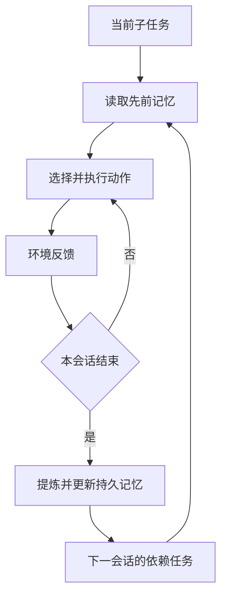

# MemoryArena：在相互依赖的多会话智能体任务中评测智能体记忆

> 检查 Agent 能否把前面任务的经验用于后续相互依赖的任务。

**英文题名**：Benchmarking Agent Memory in Interdependent Multi-Session Agentic Tasks  
**发表／版本**：2026 ICML  
**原文入口**：[主文](https://proceedings.mlr.press/v306/he26am.html) · [arXiv](https://arxiv.org/abs/2602.16313)  
**本篇阅读依据**：arXiv v1；正式 ICML 入口另列  
**更新日期**：2026-10-23

---

## 1. 它提出的关键问题：记住以后，事情办成了吗

一个助手可以准确回答“昨天买了某型号相机”，但今天仍买了不兼容的镜头。它完成了回忆，却没有把历史转化为正确行动。

MemoryArena 针对这一差距设计跨会话、子任务相互依赖的环境。早期行动产生信息，信息进入记忆，后续行动必须使用这些内容，形成 Memory–Agent–Environment 循环。[1，§3]

它不是提出新的记忆算法，而是改变评价问题：从“能否复述过去”转向“能否利用过去继续完成任务”。

## 2. 为什么一定要让子任务相互依赖

如果第一天买书，第二天查天气，两个任务可以独立完成。把它们串起来并不能强迫系统使用长期记忆。

如果第一天选相机机身，第二天必须选兼容镜头，第三天再选适配配件，后面的任务就依赖前面的实际选择，而非只依赖最初用户指令。系统需要保存执行产生的信息，而不只是任务描述。

每个子任务作为独立会话运行，完成后历史不再自动直接可见，必须通过持久记忆保存和读取。这样才能真正检验跨会话状态。[1，§3.2]

## 3. 四类环境分别挑战什么

### 组合购物

用户分多次选相关商品，后续选择需要兼容先前商品的属性，并符合附加要求。数据包括兼容候选与干扰项，链条由人工核验。模型必须记住实际买了什么，不能只记“正在购物”。

### 群体旅行规划

不同成员有不同偏好，行程还受共同活动与先前安排限制。后续安排要满足越来越多的依赖和约束。这考的不只是记住每个人一句偏好，还包括长程约束组合。

### 渐进信息搜索

用户逐步增加筛选条件，最后答案必须满足之前累计的信息。若每一轮只解决最新条件，就会丢掉整体目标。

### 连续形式推理

数学或物理子问题的结果成为后续推理的前提。需要记住结论，也要保留适用条件与必要推导，避免在新问题中错误套用。[1，§3.1]

各环境分别构建任务组，每个任务组内部包含多个子任务。统计规模时必须区分任务组、会话和子任务，不能把它们当作普通独立 QA 的问题数理解。

## 4. 一个运行循环怎样发生

Agent 在当前会话读取指令、工具观察与会话内轨迹，并从持久记忆取回相关信息，然后选择动作。任务结束后，把这段经历写入记忆，继续下一会话。

同一个抽象接口允许不同记忆方法参评：长上下文直接保留历史，RAG 保存片段后检索，专门记忆系统再增加抽取和组织。比较对象是不同的跨会话信息路径。[1，§3.2–§4.1]

## 5. 为什么只报最终成功率不够

任务链很长时，系统可能做对前五步、错在第六步。最终成功率会把它与第一步就失败的系统都记为失败，信息太粗。

论文另外报告 Progress Score：对每个任务，计算完成子任务的比例，再在任务间平均。它帮助识别系统是否至少取得局部进展。

成功判定也因环境而异：购物与旅行看最终组合或行程是否满足约束；渐进搜索和形式推理看最后的结论子任务。不能简单说所有环境都要求每个中间回答绝对正确才算成功。[1，§4.2]

对于群体旅行这种硬指标几乎全为零的情况，作者还引入按约束满足比例给部分分数的 soft progress，避免所有系统看起来完全一样。

## 6. 实验最值得注意的三个发现

### 局部进展不等于整体一致

许多方法的进度分明显高于最终成功率，说明能完成部分子任务，却难以把结果持续一致地接到后面。随着依赖深度增加，表现普遍下降。

### 外部记忆不是总比长上下文好

论文观察到，外部系统返回压缩、分段或重新排序的信息，可能与 Agent 擅长利用的原始上下文形式不一致；Agent 也未必学会如何有效查询与融合外部记忆。所以“模型强 + 记忆复杂”不保证叠加收益。[1，§4.3–§4.4]

### 有些任务确实更需要选择性整理

长搜索轨迹与复杂推理容易出现注意负担、噪声与错误累积。在这些环境中，外部记忆对任务相关内容的提炼可能提供帮助。结论是场景依赖，而不是某一种记忆范式统一胜出。

## 7. 延迟测量有什么特别之处

论文还统计子任务完成时间。它包含执行、读取和与环境交互的综合代价，不是只测向量搜索毫秒数。

某种结构更复杂，但如果它让 Agent 少走许多无效步骤，总耗时仍可能更好；某种检索很快，但返回噪声导致额外动作，总体也可能更慢。作者据此提醒，记忆操作复杂程度不能直接预测端到端效率。[1，§4.5]

## 8. 怎样用它的思想设计业务评测

以下是本文延伸。数据库 Agent 第一轮找到实例的正确监控入口，并确认只能只读诊断；第二轮处理相关告警，必须复用入口、遵守限制、避免重复已排除的检查。

评价不只问它能否复述限制，还看实际调用是否遵守、证据是否重复采集、最终诊断是否正确。为了隔离记忆贡献，还应固定模型与工具，比较给定历史、有记忆和无记忆的条件。

这类业务题可以借鉴 MemoryArena 的依赖结构，但不能直接拿其原始任务分数代表数据库运维效果。

## 9. 总结

MemoryArena 把长期记忆从静态问答带回连续行动，强调经历是在执行中形成、又必须在后续执行中使用。它通过互相依赖的会话、进度与成功指标，暴露了“记得住”与“做得好”的差距。

## 10. 我的看法

我认为这篇对 Agent 平台的价值很大，因为它迫使记忆系统证明自己影响了真实行为。一个只会事后解释历史的系统，还不能说明已经具备长期任务能力。

但这种综合评测也更难归因。失败可能来自浏览器操作、规划、约束求解，也可能来自写入或检索。低总分不应该简单解读为“记忆完全没用”，而应结合每一步取回了什么、用了什么、做错了什么分析。

我会把它与 LongMemEval 等能力测试搭配：前者测真实循环，后者定位信息能力。长期看，最有说服力的指标不是记忆条目数，而是后续任务少犯了多少重复错误、少付出了多少无效操作、是否持续满足约束。

---

## 原文与引用

[1] [本文详细解析依据的正文](https://arxiv.org/html/2602.16313v1)。正文中的章节与表格编号以此版本为准。

[2] [主文／正式发表入口](https://proceedings.mlr.press/v306/he26am.html)。

文中的教学案例用于解释机制；“我的看法”是独立分析。实验数字为作者报告，本仓库未独立复现。

[返回研究索引](../README.md) · [横向对比](../guides/comparison.md) · [版本说明](../guides/source-verification.md)
