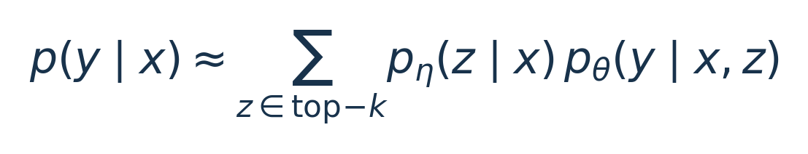
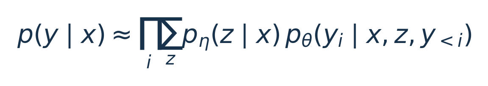

# RAG：让模型一边查资料，一边生成答案

**英文题名**：Retrieval-Augmented Generation for Knowledge-Intensive NLP Tasks  
**发表**：NeurIPS 2020  
**原文**：[论文](https://arxiv.org/abs/2005.11401)  
**阅读依据**：arXiv v4，重点为 §2–§4；实现入口核对于 2026-10-26。  
**全文版本**：[2005.11401v4](https://arxiv.org/abs/2005.11401v4)

[返回 RAG 阅读路线](../guides/rag.md) · [下一篇：DPR](21-dpr.md)

## 阅读导航

- [模型知道很多，为什么还需要查资料](#s1)
- [一次请求经过哪些组件](#s2)
- [为什么有 RAG-Sequence 和 RAG-Token](#s3)
- [没有标注正确文档，怎样训练检索器](#s4)
- [实验真正回答了什么](#s5)
- [项目实现与数据](#s6)
- [总结与看法](#s7)
- [来源](#s8)

## 模型知道很多，为什么还需要查资料

假设用户问：“项目 A 当前由谁负责？”语言模型可能在训练时见过旧负责人，但公司上周刚调整分工。即使模型把旧资料记得很牢，也不能凭空知道这次变化。重新训练模型代价高，而且很难证明它究竟依据哪段资料回答。

RAG 把知识分成两部分。模型参数保存语言能力和训练中获得的知识；外部文档保存可以独立更新的事实。回答问题时，先从外部文档找到相关段落，再让生成模型依据问题和段落输出答案。

这个想法如今很熟悉，但原论文的贡献比“先搜索，再调用大模型”更具体：它建立了一个能够联合训练查询编码器与生成器的概率模型，并比较两种结合检索结果的方法。理解这点，才能看懂论文中的损失函数和实验，而不会把后来所有 RAG 工程实践都算作这篇论文的贡献。[1，§2]

## 一次请求经过哪些组件

论文使用 DPR 检索器和 BART-large 生成器。DPR 把问题、文档分别编码成向量，利用内积找出最匹配的若干段落；BART 接收问题和某个候选段落，计算答案的生成概率。

离线阶段，需要把 Wikipedia 切成段落、编码并建立 FAISS 索引。在线阶段只编码当前问题，从索引取得 top-k 候选。论文采用 2018 年 12 月的 Wikipedia，切成互不重叠的 100 词片段，总量约 2100 万段。[1，§3]

注意这里有两个不同的分数。检索分数表达“这段材料对于当前问题有多值得参考”；生成概率表达“如果看了这段材料，模型有多倾向于生成这个答案”。二者共同决定答案，而不是把检索排名第一的段落直接宣布为真相。

## 为什么有 RAG-Sequence 和 RAG-Token

设问题为 x，候选文档为 z，完整答案为 y。RAG-Sequence 的核心可简写为：

  

[公式源码](../assets/formulas/20-rag-sequence.tex)

直观上，对每个候选段落分别问：“参考它生成整个答案，有多合理？”再按检索概率加权。这里并不是先挑一份文档就永远不看其他文档，而是对多个文档条件下的答案概率求和，只是每条生成路径内部始终条件于同一个文档。

RAG-Token 把这个加权动作放到每一个输出 token 上：

  

[公式源码](../assets/formulas/20-rag-token.tex)

因此，不同位置可以从不同文档条件分布中获得支持。它并不意味着每输出一个字，都重新访问搜索服务；论文的区别首先是概率如何组合。[1，§2.1]

用一组人为构造的数字说明 Sequence。假设两个段落的检索权重是 0.6 和 0.4，二者生成“负责人是乙”的概率分别是 0.8 和 0.1，那么这个答案得到的加权概率是 **0.6 × 0.8 + 0.4 × 0.1 = 0.52**。这个算例只解释计算方式，不代表真实模型概率，也不等于答案有 52% 的现实真实性。

## 没有标注正确文档，怎样训练检索器

训练样本主要给出问题和目标答案。系统尝试提高目标答案的总概率，能够帮助生成正确答案的候选文档便获得训练信号。文档在这里相当于没有直接给定的中间变量。

一个容易被“端到端训练”掩盖的细节是：论文固定文档编码器和文档索引，只更新查询编码器与 BART。原因很实际——文档编码器一变，整个语料库的向量就可能需要重新计算。固定文档侧，让联合训练的成本可控。[1，§2.4]

这也说明向量索引与模型版本之间存在约束。若工程上只换了查询模型，却没有确认它与现有文档向量仍处于匹配的空间，索引可以正常返回结果，语义排序却可能已经失效。这是从架构中推导出的工程提醒。

## 实验真正回答了什么

论文覆盖开放域问答、事实验证和文本生成。问答包括 Natural Questions、TriviaQA、WebQuestions、CuratedTREC；FEVER 用于事实验证；另有 MS MARCO 与 Jeopardy 生成任务。[1，§3–§4]

这些任务支持的结论是：外部检索能够增强生成模型在知识密集任务上的表现，而且收益不限于直接从原文抽取一个短答案。文章还讨论了替换外部知识后答案随之更新的例子。

但“能换索引更新知识”不代表系统已经解决版本冲突。若旧负责人、新负责人同时被召回，概率混合不会自动理解哪个版本已经生效；若 top-k 全部漏掉正确证据，生成器仍可能依靠参数记忆猜测。论文中的任务表现，也不是引用完整性、权限控制或实时数据一致性的验证。

阅读实验时，应把检索质量、生成质量和知识更新能力分开。问答分数提高，可能来自更好的段落，也可能来自生成器更善于组织答案，不能只凭最终分数认定某个组件贡献最大。

## 项目实现与数据

论文的实现并入 Hugging Face Transformers，可从 [RAG 模型文档](https://huggingface.co/docs/transformers/model_doc/rag) 进入。核心对象包括 `RagRetriever`、`RagSequenceForGeneration` 和 `RagTokenForGeneration`，公开模型包含 `facebook/rag-sequence-nq`。这是一套特定模型架构的实现，不是任意聊天模型接入任意向量库的通用服务框架。[2]

读代码时可以按数据流看三个位置：检索器如何把查询转成候选文档；候选文档如何分别构成模型输入；生成阶段如何处理 `doc_scores` 并合并概率。这样能对应上论文的两种边缘化方式。

数据需要同时准备问答集、文档语料和与模型匹配的向量索引。只有问答 JSON 并不能运行完整实验；只下载模型也不意味着已经具备 Wikipedia 检索能力。原始 Wikipedia 快照、段落 ID 和预计算向量必须对齐。

如果只是学习原理，我会先使用少量自建文档观察候选文档与输出变化，再考虑完整索引。这个小实验能验证流程，但不能据此声称复现了论文分数。本篇核对了论文与实现入口，没有运行模型实验。

## 总结与看法

RAG 最重要的改变，是把知识访问变成生成过程的一部分，让知识更新不必总与模型训练绑定。原论文通过概率模型说明了“检索的可靠程度”和“答案生成的合理程度”怎样结合，比简单的流程图更有解释力。

我认为今天读它，最有价值的不是照搬 BART 与 DPR 的组合，而是弄清三个边界：外部资料与参数知识的边界，检索相关性与事实正确性的边界，以及联合训练与索引维护的边界。对于知识底座，可靠的来源、版本和权限仍然需要单独设计；这篇论文提供了知识进入生成模型的方法，没有代替这些工程职责。

## 来源

1. [Lewis et al.，论文全文](https://arxiv.org/abs/2005.11401)，§2 方法、§3 实验设置、§4 结果与分析。
2. [Transformers：RAG](https://huggingface.co/docs/transformers/model_doc/rag)，模型类、检查点与检索接口。
